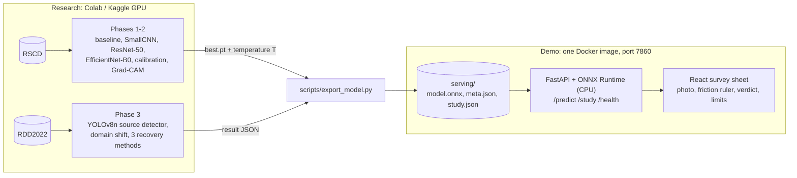

# Road Condition AI

Camera-based **road surface (friction) classification** on RSCD, plus a **cross-country road-damage
detection study** on RDD2022, served as a small web demo. It is a student portfolio project: the
code, the experiments and the demo are real, and every number below comes from saved result files
(or says "pending").

**Demo status:** the web app, API, ONNX export and Docker image are built and tested on mock data.
The real training runs (Colab or Kaggle GPU) have not been added yet, so the demo ships with a mock
model and says so on every screen.

## Architecture



Research and serving meet only in the `serving/` folder. The server needs no PyTorch: the ONNX graph
contains the normalisation and a class-activation-map output, so heatmaps need no gradients.

## Quick start

```bash
make setup        # one command: Python and frontend dependencies (Python 3.11+, Node 22+)
make demo-mock    # one command: builds a random-weight demo bundle and serves http://localhost:8000
```

`make demo-mock` needs no download and no training; its answers mean nothing and are labelled so.
For the real model, train on Colab (Phases 1-3 below), then:

```bash
python scripts/export_model.py bundle --checkpoint <best.pt> --results <results/model.json> --out serving
python scripts/export_model.py study --results-dir artifacts/results --out serving/study.json
make demo                  # or: docker compose up --build   (http://localhost:7860)
```

Other targets: `make test` (ruff, pytest, frontend type check and tests: what CI runs), `make docker`.

## Results

Generated from the saved result files by `python scripts/render_results.py --results-dir artifacts/results --readme README.md`.
Cells say "pending" until the real runs exist; nothing here is typed in by hand.

<!-- results:start -->

#### Surface classification (RSCD, six friction classes)

| model         | val macro-F1 | test macro-F1 | test accuracy | test ECE before -> after |
|---------------|--------------|---------------|---------------|--------------------------|
| logreg        | pending      | pending       | pending       | pending                  |
| random_forest | pending      | pending       | pending       | pending                  |
| small_cnn     | pending      | pending       | pending       | pending                  |
| resnet50      | pending      | pending       | pending       | pending                  |
| efficientnet  | pending      | pending       | pending       | pending                  |

No classifier results found yet: run the Phase 1 and Phase 2 scripts.

#### Cross-country damage detection (YOLOv8n, RDD2022)

Pending: the detection experiments have not been run (scripts/run_phase3.sh).

<!-- results:end -->

Plots are written next to the results by the training scripts (`loss_curves.png`, `reliability_<split>.png`,
`gradcam_<split>.png`, the detection learning curve); the write-up is in
[`docs/study_writeup.md`](docs/study_writeup.md).

## Limitations and future work

- **No real results yet.** Everything above was built and tested on synthetic mock data; the demo's
  model is random weights and is labelled as such. The tables fill in after the Colab / Kaggle runs.
- **RSCD comes from China only.** The classifier's behaviour on Nordic roads, at night or with rain on
  the lens is unknown. The demo shows this on every screen and returns "Not sure" below 50 %
  calibrated confidence (a default I chose; the PRD gives no value, so tune it on validation data).
- **The demo cannot tell that a photo is not a road.** The model has six road classes and no
  "not a road" class; low confidence is the only guard.
- **Own detection split.** RDD2022 test labels are not public, so detection scores are on my own
  per-country split and are not comparable with the challenge leaderboard.
- **The heatmap is a class activation map** at the last feature map (equal to Grad-CAM there, and
  checked by a test): coarse, and evidence of where the model looked, not of why it is right.
- **Licences.** Ultralytics is AGPL-3.0; check dataset terms and choose the repository licence before
  publishing code, weights or sample images. The bundled sample pictures are generated placeholders.
- **Future work:** class-imbalance comparison and a hyperparameter sweep (C6, C7), a ViT / DINOv2
  backbone (C10), radar data for road surface condition (no public dataset found), and visual
  localisation under changing conditions (L1).

## Install options

```bash
python3.11 -m venv .venv && source .venv/bin/activate
pip install -e ".[dev,classical]"   # add ,notebook / ,train / ,detect / ,export / ,serve as needed
pytest
```

Datasets go in `data/raw/` and are not committed. Saved split file lists go in `data/splits/` and are committed.

## Phase 1: RSCD data and classical baseline (C1, C2, C5)

| Step | Command | Output |
|---|---|---|
| Split files | `python scripts/prepare_rscd.py --root <RSCD>` | `data/splits/rscd_{train_subset,val,test}.csv`, `rscd_leak_report.json` |
| Tune baseline | `python scripts/train_baseline.py --root <RSCD>` | validation table, `artifacts/results/baseline.json` |
| Final run | `python scripts/train_baseline.py --root <RSCD> --eval-test` | test table (run once per final model) |
| EDA | `notebooks/01_rscd_eda.ipynb` with `RSCD_ROOT=<RSCD>` | class counts, sample grid, image stats, split checks |

- The train subset is 40,000 images, balanced over the 6 friction classes and spread over the
  material/unevenness sub-labels, drawn once with seed 0. Official val and test are listed, not sampled.
- A train image within 4 bits (dHash) of any val/test image is dropped and replaced from the
  same class; the leak report lists counts and example pairs to inspect in the notebook.
- The split folder names (`train`, `vali_20k`, `test_50k`) and the label parsing are assumptions
  until checked against the real download; change `rscd.split_dirs` / `rscd.label_source` in
  `configs/default.yaml` if they differ. Unknown labels stop the run with an error.

**Local dry run on mock data** (no download needed):

```bash
python -m roadcond.data.mock --out data/raw/rscd_mock
python scripts/prepare_rscd.py --root data/raw/rscd_mock --splits-dir data/processed/mock_splits --train-size 120
python scripts/train_baseline.py --root data/raw/rscd_mock --splits-dir data/processed/mock_splits --eval-test
```

**Google Colab** (numpy, pillow, pyyaml, scikit-learn and scikit-image are preinstalled):

```python
from google.colab import drive; drive.mount("/content/drive")
!git clone https://github.com/siddharth250305/road-conditions-Ai.git
%cd road-conditions-Ai
# Reading ~110k small files from Drive is slow: unzip to local disk first.
!unzip -q /content/drive/MyDrive/RSCD.zip -d /content/rscd
!bash scripts/run_phase1.sh /content/rscd               # tune on validation
!bash scripts/run_phase1.sh /content/rscd --eval-test   # final test run
```

**Kaggle**: add the dataset as notebook input, then run the same `git clone` and
`!bash scripts/run_phase1.sh /kaggle/input/<dataset-folder>`. Inputs are read-only; all
outputs land in the clone under `/kaggle/working`.

Afterwards, commit `data/splits/` back to the repo so every later run uses the same files.
Feature caches (`data/processed/`) and results (`artifacts/`) stay out of git.

## Phase 2: deep classifiers (C3, C4, C8, C9)

Small CNN (from scratch), fine-tuned ResNet-50 and EfficientNet-B0 (timm), trained on the saved
split files from Phase 1. Settings live in the `classifier:` section of `configs/default.yaml`.

| Model | Epochs / patience | Notes |
|---|---|---|
| `small_cnn` | 30 / 6 | 4 x (Conv, BatchNorm, ReLU, MaxPool, Dropout), global average pooling |
| `resnet50`, `efficientnet` | 12 / 4 | head-only for 1 epoch, then the whole network at a 10x smaller backbone learning rate |

AdamW, cosine annealing, early stopping on validation macro-F1, mixed precision on GPU. A checkpoint
is written every epoch, so after a Colab timeout rerun the same command with `--resume`.
After training, a temperature is fitted on **validation** logits; ECE before and after scaling is
reported for validation and (with `--eval-test`) for test. Judge H4 on the test numbers.

```bash
python scripts/train_classifier.py --model resnet50 --root <RSCD>                     # tune on val
python scripts/train_classifier.py --model resnet50 --root <RSCD> --eval-test --gradcam 4
```

Outputs in `artifacts/` (git-ignored): `checkpoints/<model>_seed<n>/{best,last}.pt`, `history.json`,
`loss_curves.png`, `reliability_<split>.png`, `gradcam_<split>.png`, and `results/<model>.json`
(same shape as `baseline.json`, so the H1 table can compare all models).

**Google Colab** (use a GPU runtime; torch and torchvision are preinstalled):

```python
!git clone https://github.com/siddharth250305/road-conditions-Ai.git
%cd road-conditions-Ai
!unzip -q /content/drive/MyDrive/RSCD.zip -d /content/rscd   # local disk, not Drive
# data/splits/ must exist: run scripts/run_phase1.sh once, or commit the split files.
!bash scripts/run_phase2.sh /content/rscd                        # all three models, val only
!bash scripts/run_phase2.sh /content/rscd --eval-test --gradcam 4   # final run, once
!bash scripts/run_phase2.sh /content/rscd --resume               # continue after a timeout
```

Copy `artifacts/` to Drive before the session ends. To run one model, call
`scripts/train_classifier.py --model <name>` directly. Use `--limit 500 --epochs 1` for a quick
dry run before the full job.

Local check without any download: `pytest tests/test_dl.py` (needs `pip install -e ".[dev,train]"`).

## Phase 3: cross-country damage detection (D1-D5)

A YOLOv8 detector trained on one country (Japan) and scored on others (Norway, Czech Republic,
USA), then three ways to recover the lost accuracy. Install with `pip install -e ".[dev,detect]"`.
**Ultralytics is AGPL-3.0**: it stays in the optional `detect` extra; decide the repository
licence before making it public.

| Step | Command | PRD |
|---|---|---|
| Split countries, write lists and data configs | `prepare --root <RDD2022>` | data rules |
| Train on Japan, score every country | `source` | D1 |
| Same with weather augmentation, no target images | `source --augment` | D2 |
| Fine-tune on 10 / 50 / 200 target labels, 3 seeds | `fewshot` | D3, D5 |
| Pseudo-label unlabelled target images, retrain | `pseudo` | D4 |
| Tables, learning curve, `detection_report.md` | `report` | D1-D5 |

Run each as `python scripts/train_detection.py <step> [options]`, or all of them with
`bash scripts/run_phase3.sh <RDD2022>`. Finished work is skipped, so after a Colab timeout rerun
the same command (add `--resume` to continue a half-trained source detector).

- **Splits.** RDD2022 test labels are not public, so each country gets its own seeded
  70 / 10 / 20 % train-pool / val / test split from its labelled images; pool images that nearly
  duplicate a val/test image are dropped. The exact lists are `data/splits/rdd_<country>_*.txt`
  (commit them). The generated `data/splits/rdd_*.yaml` hold absolute paths and are git-ignored.
- **Recipe.** Source: YOLOv8n, 640 px, 30 epochs, at most 5,000 Japanese images (a cap for free
  Colab; `--max-train-images` changes it). Few-shot: fixed recipe, backbone frozen, final weights
  scored, never tuned on target data; the 10 images are inside the 50, inside the 200, per seed.
- **Metrics.** mAP@0.5 and mAP@0.5:0.95 from Ultralytics; F1 at a fixed confidence of 0.25 from
  our own matcher. Relative gap = (source - target) / source; "gap recovered" is `n/a` when the
  target is not worse than the source.
- **Test split** of each country is scored once per final model. Pseudo-label thresholds
  {0.3, 0.5, 0.7} are chosen on target *validation* images, which is the one place target labels
  influence a label-free method; the results file says so.

**Google Colab** (GPU runtime; torch is preinstalled):

```python
!git clone https://github.com/siddharth250305/road-conditions-Ai.git
%cd road-conditions-Ai
# Put the RDD2022 download on local disk first, e.g. unzip it to /content/rdd2022
!bash scripts/run_phase3.sh /content/rdd2022
!bash scripts/run_phase3.sh /content/rdd2022 --resume      # after a disconnect
```

Copy `artifacts/` and `data/splits/rdd_*.txt` to Drive before the session ends. Dry run first:
`bash scripts/run_phase3.sh /content/rdd2022 --epochs 1 --imgsz 320`.

Local check without any download: `pytest tests/test_detection.py` (39 tests, about 10 seconds,
including a real Ultralytics run on a synthetic mock dataset).

## Phase 4: ONNX export and demo API (W1, W2, W3)

A trained classifier becomes a small **bundle** (`model.onnx`, `meta.json`, optionally
`study.json`), and a FastAPI service answers from that folder alone. Install with
`pip install -e ".[dev,export,serve]"`; the server itself needs only `.[serve]` (no torch).

```bash
# 1. Export: PyTorch checkpoint -> one ONNX file, checked against PyTorch (tolerance 1e-4)
python scripts/export_model.py bundle --checkpoint <best.pt> --results <results/model.json> --out serving
# 2. The cross-country benchmark for the demo's study view (from the Phase 3 result files)
python scripts/export_model.py study --results-dir artifacts/results --out serving/study.json
# 3. Serve
ROADCOND_BUNDLE_DIR=serving uvicorn api.main:app --port 8000      # docs at /docs
curl -F file=@road.jpg localhost:8000/predict
```

| Endpoint | Returns |
|---|---|
| `POST /predict` (multipart `file`, optional `?heatmap=false`) | `prediction`, calibrated `confidence`, `is_uncertain` + `display_label` ("Not sure"), `top2`, all `probabilities`, `heatmap_base64` (PNG overlay), `limits_note` |
| `GET /study` | slope-chart points (source vs target mAP) and the few-shot learning curve, from your measured results only; 404 if absent |
| `GET /health` | status, model, classes; 503 if no model is loaded |

- **The ONNX graph contains the normalisation**, so the server only resizes the picture (Pillow,
  no torch). Its second output is a per-class activation map: for SmallCNN, ResNet-50 and
  EfficientNet-B0 this equals Grad-CAM at the last feature map (a test checks it), so heatmaps
  need no gradients at serving time.
- **Confidence is calibrated:** softmax of logits divided by the temperature stored in `meta.json`
  (fitted in Phase 2 on validation data). "Not sure" appears when it is below 0.5
  (`ROADCOND_UNCERTAINTY_THRESHOLD`; the PRD gives no value).
- **Errors:** 400 empty or corrupt files, 413 too many bytes (10 MB) or pixels (50 million),
  422 missing `file`, 503 no model. Settings: `ROADCOND_BUNDLE_DIR`, `ROADCOND_MAX_UPLOAD_MB`,
  `ROADCOND_MAX_PIXELS`, `ROADCOND_HEATMAP_ALPHA`, `ROADCOND_CORS_ORIGINS` (only for a separate
  dev frontend).
- **A bundle built from `--mock` data says so** in `/health` and in the limits note.
- `.onnx` files are git-ignored. ResNet-50's is about 94 MB: ship it through Git LFS or the
  Hugging Face Hub, not a plain commit.

Local check without any download or training: `pytest tests/test_export.py tests/test_api.py`
(48 tests, about 20 seconds).

## Phase 5: web app, Docker and CI (W1, W2, R1, R2)

A React page in the "road survey sheet" style (PRD pages 9-11): the photo sits in a specimen frame
with crop marks, a vertical friction ruler runs dry to ice with a marker at the answer, and a
rubber-stamp verdict gives the class. Vite, React, TypeScript and Tailwind CSS; D3 does the chart
maths and React draws the SVG. Fonts (Big Shoulders Display, IBM Plex Mono, Public Sans) are bundled
with `@fontsource`, so the page makes no third-party requests.

| Screen / state | What it shows |
|---|---|
| Report, empty | a blank specimen frame as the drop area, three generated sample pictures |
| Report, result | photo with a 180 ms heatmap crossfade toggle, ruler marker (300 ms ease-out), stamp (120 ms settle), calibrated confidence |
| Report, low confidence | "Not sure", the top two classes, never a forced label |
| Report, error / offline / no model | fixed messages; retry only where retrying can help |
| Study | slope chart (source mAP to target mAP per country) and learning curve over 0, 10, 50, 200 labels, with the numbers in a table |
| Limits | a strip on every screen and an expandable panel: training data, country, what the model has not seen, calibration, provenance |

```bash
cd frontend && npm ci
npm run dev            # http://localhost:5173, proxies the API on :8000 (run `make demo-mock` in another shell)
npm test               # 75 tests: API client, state machine, ruler, charts, contrast, motion, flows
npm run build          # writes frontend/dist, which the API serves at /
```

- **One service.** `api/main.py` serves `frontend/dist` at `/` after every API route (set
  `ROADCOND_FRONTEND_DIR` to change the folder), so the page and the API share one origin.
- **Docker.** `docker compose up --build` builds the React page with Node, then a slim Python image
  (no torch) with FastAPI and ONNX Runtime on port 7860, as a non-root user. The model bundle is read
  from `./serving` (not in git); without one the page loads and says no model is loaded.
- **Hugging Face Space (Docker SDK).** The image already follows the Space rules (port 7860, uid 1000).
  Not deployed yet. In the Space repository, put this at the top of its `README.md`, add the
  `serving/` files with Git LFS (ResNet-50's `model.onnx` is about 94 MB), and push:

  ```yaml
  ---
  title: Road Condition AI
  sdk: docker
  app_port: 7860
  ---
  ```
- **Sample pictures** are drawn by `python scripts/make_samples.py` (no licence terms, no class
  label). Replace `frontend/public/samples/sample-N.jpg` with photos you may use before publishing.
- **Accessibility.** Keyboard use throughout, a yellow focus ring on ink, alt text stating class and
  confidence, results announced through a live region, all motion off under `prefers-reduced-motion`,
  and a dark variant. A test checks the contrast of every text pair against the stylesheet.
- **CI.** `.github/workflows/ci.yml` runs ruff and pytest on Python 3.11 and 3.12, the ML and ONNX
  tests with CPU torch, the frontend type check, tests and build, and a Docker build with a smoke test.

Local check without any download or training: `make test`.
