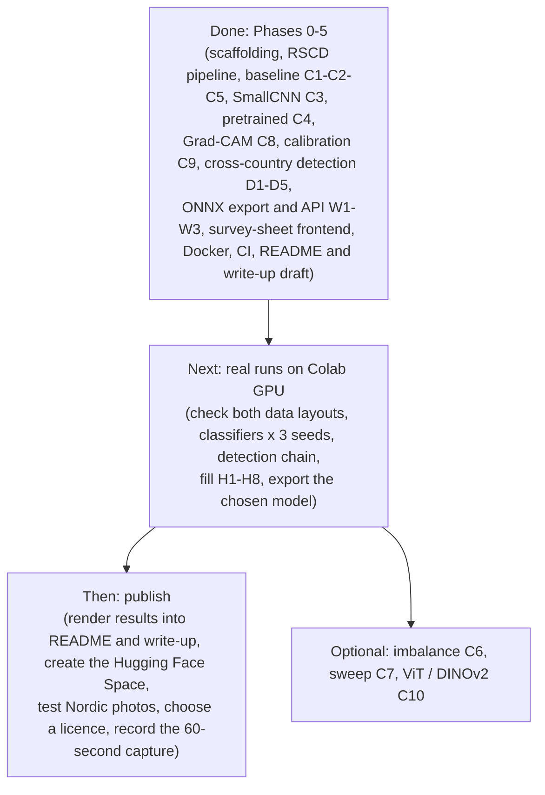

# Road Condition AI: System Guidance & Verification Manual

This document explains what has been built in the **Road Condition AI** repository, how each component works, and how you can check every requirement yourself against the [PRD](Road%20Condition%20AI%20PRD.pdf). Every command in section 4 was run on the mock dataset, and the outputs shown are the real ones.

---

## Table of Contents
1. [Executive Summary & Current Status](#1-executive-summary--current-status)
2. [PRD Requirements Coverage Matrix](#2-prd-requirements-coverage-matrix)
3. [What Was Built (Component Deep Dive)](#3-what-was-built-component-deep-dive)
   - [3.1 Configuration & Package Setup](#31-configuration--package-setup)
   - [3.2 The Anti-Leak RSCD Data Pipeline](#32-the-anti-leak-rscd-data-pipeline)
   - [3.3 The Synthetic Mock Data Engine](#33-the-synthetic-mock-data-engine)
   - [3.4 The Pure-NumPy Metric Engine](#34-the-pure-numpy-metric-engine)
   - [3.5 The Classical Machine Learning Baseline](#35-the-classical-machine-learning-baseline)
   - [3.6 PyTorch Dataset & Transforms](#36-pytorch-dataset--transforms)
   - [3.7 SmallCNN (Req C3)](#37-smallcnn-req-c3)
   - [3.8 Pretrained ResNet-50 & EfficientNet-B0 (Req C4)](#38-pretrained-resnet-50--efficientnet-b0-req-c4)
   - [3.9 Training Engine & Early Stopping](#39-training-engine--early-stopping)
   - [3.10 Temperature Scaling & Calibration (Req C9)](#310-temperature-scaling--calibration-req-c9)
   - [3.11 Grad-CAM Explainability (Req C8)](#311-grad-cam-explainability-req-c8)
   - [3.12 Standalone Cloud Scripts](#312-standalone-cloud-scripts)
   - [3.13 Exploratory Data Analysis (EDA) Notebook](#313-exploratory-data-analysis-eda-notebook)
   - [3.14 RDD2022 Data Layer (Parsing, Splits, YOLO Tree, Mock Data)](#314-rdd2022-data-layer-parsing-splits-yolo-tree-mock-data)
   - [3.15 Detection Metrics (Box Matching, F1, Domain Gap)](#315-detection-metrics-box-matching-f1-domain-gap)
   - [3.16 Source Detector (Req D1)](#316-source-detector-req-d1)
   - [3.17 Weather Augmentation (Req D2)](#317-weather-augmentation-req-d2)
   - [3.18 Few-Shot Fine-Tuning and the Learning Curve (Req D3, D5)](#318-few-shot-fine-tuning-and-the-learning-curve-req-d3-d5)
   - [3.19 Pseudo-Labelling (Req D4)](#319-pseudo-labelling-req-d4)
   - [3.20 Detection Command Line and Colab Scripts](#320-detection-command-line-and-colab-scripts)
   - [3.21 ONNX Export and the Serving Bundle (Req W3)](#321-onnx-export-and-the-serving-bundle-req-w3)
   - [3.22 Serving Logic (Req W1, W2)](#322-serving-logic-req-w1-w2)
   - [3.23 The Demo API](#323-the-demo-api)
   - [3.24 The Survey-Sheet Frontend (Req W1, W2)](#324-the-survey-sheet-frontend-req-w1-w2)
   - [3.25 Docker Image and Continuous Integration](#325-docker-image-and-continuous-integration)
   - [3.26 Results Tables and the Study Write-Up (Req R1, R2)](#326-results-tables-and-the-study-write-up-req-r1-r2)
4. [Step-by-Step Manual Verification Playbook](#4-step-by-step-manual-verification-playbook)
   - Phase 1: [Tests 1-6](#phase-1-data-pipeline-metrics-and-classical-baseline)
   - Phase 2: [Tests 7-13](#phase-2-deep-learning-classifier)
   - Phase 3: [Tests 14-20](#phase-3-cross-country-damage-detection)
   - Phase 4: [Tests 21-28](#phase-4-onnx-export-and-the-demo-api)
   - Phase 5: [Tests 29-35](#phase-5-frontend-docker-ci-and-documentation)
5. [Reading the Results Against the PRD Hypotheses](#5-reading-the-results-against-the-prd-hypotheses)
6. [Running the Real Experiments on Google Colab](#6-running-the-real-experiments-on-google-colab)
7. [Known Limitations & Assumptions](#7-known-limitations--assumptions)
8. [What Remains to Be Built (Next Phases)](#8-what-remains-to-be-built-next-phases)

---

## 1. Executive Summary & Current Status

The repository contains the completed code for **Phase 0 (scaffolding)**, **Phase 1 (RSCD data pipeline and classical baseline)**, **Phase 2 (deep-learning surface classifier)**, **Phase 3 (cross-country YOLO damage detection and domain shift)** **Phase 4 (ONNX export and the demo API)** and **Phase 5 (survey-sheet web page, Docker image, CI workflow, README and write-up)**.

**What is verified:** all 167 Python tests and all 75 frontend tests pass on mock data (CPU only), `ruff` is clean on `src`, `tests`, `scripts` and `api`, and every command in section 4 runs. The web page was opened in a real browser (light, dark and phone width) against a running server, and the Docker image was built and run with and without a model. The exported ONNX model matches PyTorch to about 1e-6 (the requirement is 1e-4), and the API has been run as a real `uvicorn` server and exercised with `curl`. A real pretrained EfficientNet-B0 (weights downloaded from Hugging Face) has been run end to end through the classifier script, and a real COCO-pretrained YOLOv8n has been run through the whole detection chain (source detector, weather augmentation, few-shot, pseudo-labelling, report) on mock data.

**What is not verified yet:** the GitHub Actions workflow has been written and its Python job simulated locally, but it has **not run on GitHub**; the Hugging Face Space has not been created; no model has been trained on the real RSCD or RDD2022 data, so there are **no real accuracy numbers**. The GPU and mixed-precision (AMP) code paths have not been run, because they need a CUDA machine. The assumed RSCD and RDD2022 folder layouts (section 7) still have to be checked on the real downloads. Mock scores mean nothing: the mock classes differ only by colour or by drawn shapes.

### Why this foundation matters
1. **A leakage-free, balanced data subsetter** stops near-identical consecutive frames from inflating scores.
2. **A pure-NumPy evaluation system** reports macro-F1 instead of misleading raw accuracy.
3. **A classical baseline** (colour histograms + HOG into logistic regression and random forest) sets the bar the deep models must beat (hypothesis H1).
4. **Three deep classifiers with the same evaluation**, plus calibration and Grad-CAM, so the models can be compared fairly and their confidence and attention can be inspected.
5. **A cross-country detection study** that trains on one country, measures the accuracy lost on others, and compares three ways to win it back (weather augmentation, a few target labels, pseudo-labels) under the same held-out splits and metrics.

---

## 2. PRD Requirements Coverage Matrix

| PRD Req ID | Description | Status | Files | How to Verify |
| :--- | :--- | :--- | :--- | :--- |
| **C1** | EDA notebook: class counts, sample grid, image stats, split sanity checks | Complete | [`notebooks/01_rscd_eda.ipynb`](notebooks/01_rscd_eda.ipynb) | Open in Jupyter or Colab and run all cells |
| **C2** | Classical baseline: colour histogram + HOG into logistic regression & random forest | Complete | [`models/baseline.py`](src/roadcond/models/baseline.py) | Test 5 |
| **C3** | Small CNN written from scratch | Code complete, mock-verified; real run pending | [`models/small_cnn.py`](src/roadcond/models/small_cnn.py), [`train.py`](src/roadcond/train.py) | Tests 7, 9 |
| **C4** | Fine-tuned pretrained ResNet-50 / EfficientNet | Code complete, mock-verified; real run pending | [`models/pretrained.py`](src/roadcond/models/pretrained.py) | Tests 8, 9 |
| **C5** | Evaluation report: macro-F1, per-class precision/recall, confusion matrix | Complete | [`metrics.py`](src/roadcond/metrics.py) | Tests 1, 4 |
| **C6** | Imbalance handling compared (none / class-weighted / oversampling) | Not built | | |
| **C7** | Hyperparameter sweep with an experiment tracker | Not built (learning rate, freeze epochs and augmentation strength are in the config, ready for it) | | |
| **C8** | Grad-CAM heatmaps for correct and wrong predictions | Code complete, mock-verified; real run pending | [`explain.py`](src/roadcond/explain.py) | Test 10 |
| **C9** | Calibration: reliability diagram, ECE before and after temperature scaling | Code complete, mock-verified; real run pending | [`calibration.py`](src/roadcond/calibration.py) | Test 11 |
| **C10** | Optional ViT / DINOv2 comparison | Not built (P2) | | |
| **Data Rules** | Balanced 40k subset, official val/test untouched, near-duplicate rejection | Complete | [`data/rscd.py`](src/roadcond/data/rscd.py) | Test 3 |
| **D1** | YOLO detector trained on the source country, mAP per target country | Code complete, mock-verified; real run pending | [`detection/train_yolo.py`](src/roadcond/detection/train_yolo.py), [`data/rdd.py`](src/roadcond/data/rdd.py) | Tests 14-16, 19 |
| **D2** | Recovery experiment: stronger augmentation | Code complete, mock-verified; real run pending | [`detection/augment.py`](src/roadcond/detection/augment.py) | Tests 18, 20 |
| **D3** | Recovery experiment: fine-tuning with 10, 50 and 200 target labels, 3 seeds | Code complete, mock-verified; real run pending | [`detection/few_shot.py`](src/roadcond/detection/few_shot.py) | Tests 14, 19, 20 |
| **D4** | Recovery experiment: pseudo-labelling with a confidence threshold | Code complete, mock-verified; real run pending | [`detection/pseudo_label.py`](src/roadcond/detection/pseudo_label.py) | Tests 14, 19, 20 |
| **D5** | Learning curve: target mAP against number of labelled target images | Code complete, mock-verified; real run pending | [`detection/few_shot.py`](src/roadcond/detection/few_shot.py), [`detection/report.py`](src/roadcond/detection/report.py) | Tests 17, 20 |
| **Data Rules (detection)** | Own held-out split per country (no public test labels), saved lists, near-duplicate guard | Complete | [`data/rdd.py`](src/roadcond/data/rdd.py) | Test 16 |
| **W1** | Demo: upload an image or pick a sample, get condition, confidence and heatmap | Complete on a mock model; real model pending | [`api/main.py`](api/main.py), [`serving.py`](src/roadcond/serving.py), [`frontend/`](frontend/) | Tests 21, 24, 27, 29-31 |
| **W2** | Demo shows its limits: a note on training data, country, unseen conditions; "Not sure" instead of a forced label | Complete: a limits strip on every screen, an expandable panel, and a "Not sure" state with the top two classes | [`serving.py`](src/roadcond/serving.py), [`LimitsFooter.tsx`](frontend/src/components/LimitsFooter.tsx), [`VerdictPanel.tsx`](frontend/src/components/VerdictPanel.tsx) | Tests 25, 29, 31 |
| **W3** | Model exported to ONNX and served from a lightweight API | Complete on mock data; a real export needs your Colab checkpoint | [`export.py`](src/roadcond/export.py) | Tests 22, 23 |
| **UI / hosting** | React frontend, Docker image for the Hugging Face Space, CI | Frontend, Docker image and CI workflow built; the Space itself is not created, and CI has not run on GitHub | [`frontend/`](frontend/), [`Dockerfile`](Dockerfile), [`.github/workflows/ci.yml`](.github/workflows/ci.yml) | Tests 29-34 |
| **R1** | README with setup, results tables, plots, limitations and future work | Structure complete; the results tables read "pending" until real runs exist | [`README.md`](README.md), [`results_tables.py`](src/roadcond/results_tables.py) | Test 35 |
| **R2** | 2 to 4 page write-up of the cross-country study | Draft: method and decision rules written, findings pending real runs | [`docs/study_writeup.md`](docs/study_writeup.md) | Test 35 |

---

## 3. What Was Built (Component Deep Dive)

### 3.1 Configuration & Package Setup
- **[`pyproject.toml`](pyproject.toml)**: `hatchling` build backend, Python `>=3.11`, `src/` layout. The core install is light (`numpy`, `pillow`, `pyyaml`); heavy libraries are optional extras:
  - `classical`: `scikit-learn`, `scikit-image`, `joblib`
  - `train`: `roadcond[classical]`, `torch`, `torchvision`, `timm`, `grad-cam`, `pandas`, `matplotlib`, `tqdm`, `tensorboard`
  - `detect`: `ultralytics`, `albumentations` (kept separate: Ultralytics is AGPL-3.0)
  - `export`: `onnx`, `onnxruntime`; `serve`: `fastapi`, `uvicorn`, `python-multipart`, `pillow`, `onnxruntime`
  - `notebook`: `jupyterlab`, `matplotlib`; `dev`: `pytest`, `ruff`, `nbstripout`
- **[`configs/default.yaml`](configs/default.yaml)**: the single source of truth for settings:
  - Friction classes, ordered from dry to ice: `[dry, wet, water, fresh_snow, melted_snow, ice]`; image size `[240, 360]` (height, width).
  - Training subset: 40,000 images, fixed `seed: 0`. Dedup: 64-bit dHash, max Hamming distance 4.
  - `baseline:` feature sizes and the logistic regression / random forest grids.
  - `classifier:` batch size 64, workers 2, mixed precision on, weight decay 0.01, `augment_strength` 1.0, `freeze_epochs` 1, 15 calibration bins, and per-model settings:

    | Model | Epochs | Patience | Learning rate | Backbone LR |
    | :--- | :--- | :--- | :--- | :--- |
    | `small_cnn` | 30 | 6 | 0.001 | n/a (dropout 0.1) |
    | `resnet50` | 12 | 4 | 0.001 (head) | 0.0001 |
    | `efficientnet` (`efficientnet_b0`) | 12 | 4 | 0.001 (head) | 0.0001 |
  - `rdd2022:` (detection) the four damage classes (D00, D10, D20, D40 = ids 0-3), the source country (Japan) and targets (Norway, Czech, United_States), assumed folder names, the per-country split (70 / 10 / 20 %, seed 0, val capped at 500 images), the `yolo:` settings (YOLOv8n, 640 px, 30 epochs, source pool capped at 5,000 images), `augment:`, `few_shot:` (budgets 10 / 50 / 200, seeds 0 / 1 / 2) and `pseudo_label:` (threshold sweep 0.3 / 0.5 / 0.7). `metrics.detection_f1_conf` is 0.25.
  - `serving:` (demo) the default bundle folder, the "Not sure" threshold (0.5) and the ONNX tolerance (1e-4). The server itself reads only environment variables (section 3.23).
- **[`config.py`](src/roadcond/config.py)**: `load_config()` and `resolve_path()`, so relative paths work from the repo root or from inside scripts.

### 3.2 The Anti-Leak RSCD Data Pipeline
- **File**: [`src/roadcond/data/rscd.py`](src/roadcond/data/rscd.py)
- **Problem it solves**: consecutive frames from one drive look almost identical. If one lands in train and the next in test, the model scores well without learning friction.
- **How it works**:
  1. **Label mapping (`to_friction`)**: turns a full RSCD label such as `wet_concrete_slight` into its friction class (`wet`). An unknown label stops the run with an error instead of being guessed.
  2. **Balanced subset (`balanced_subset`)**: 40,000 images split over 6 classes gives quotas of 6,667 (dry, wet, water, fresh snow) and 6,666 (melted snow, ice). Inside a class, `interleave_by_label` round-robins over the material and roughness sub-labels, so the subset is not dominated by smooth asphalt.
  3. **Perceptual hash (`dhash`)**: a 64-bit difference hash computed with PIL and NumPy. Unlike MD5/SHA it stays similar when brightness or JPEG compression changes slightly.
  4. **Near-duplicate index (`NearDuplicateIndex`)**: avoids comparing every train image with every val/test image. The 64 bits are split into `max_hamming + 1` = **five bands**. Two hashes within 4 bits must agree exactly on at least one band (pigeonhole principle), so only images sharing a band value are compared.
  5. **Leak check (`LeakChecker`)**: rejects a train image within `max_hamming` bits of any val/test image. If `rscd.dedup.drive_id_regex` is set, it also rejects train images that share a drive id with a val/test image.
  6. **Replacement**: a rejected image is replaced by another from the same class, so the subset stays balanced. If a class runs out, the shortfall is logged and written to the report.
  7. **Outputs**: `data/splits/rscd_train_subset.csv`, `rscd_val.csv`, `rscd_test.csv` (columns `path, friction, label`) and the audit log `rscd_leak_report.json`.
- **Untouched splits**: val and test are only listed, never sampled. The report also counts test images that nearly duplicate val images, for information only.

### 3.3 The Synthetic Mock Data Engine
- **File**: [`src/roadcond/data/mock.py`](src/roadcond/data/mock.py)
- **Problem it solves**: the full RSCD set is about a million images, and tests should not need a download.
- **How it works**: writes small synthetic images (coloured noise, *not* realistic road photos) in the layout the config assumes: `train/<label>/*.jpg` and flat, timestamped `vali_20k` / `test_50k` folders. It deliberately plants 2 near-duplicates of test images in the training folder (`leak_000.jpg`, `leak_001.jpg`) so the leak check can be proven to work.

### 3.4 The Pure-NumPy Metric Engine
- **File**: [`src/roadcond/metrics.py`](src/roadcond/metrics.py)
- **Functions**:
  - `confusion_matrix(y_true, y_pred, n_classes)`: rows are true classes, columns are predictions. Classes that never occur keep a row of zeros. Labels outside `0..n_classes-1` raise `ValueError`.
  - `precision_recall_f1(cm)`: per-class precision = TP/(TP+FP), recall = TP/(TP+FN), F1 = 2PR/(P+R). A zero denominator gives 0.0, matching scikit-learn's `zero_division=0`.
  - `macro_f1(y_true, y_pred, n_classes)`: the unweighted mean of per-class F1, so a weak rare class (ice) cannot hide behind a strong common one.
  - `accuracy(y_true, y_pred)`, `classification_report(y_true, y_pred, class_names)` (a JSON-ready dict with accuracy, macro-F1, per-class metrics and the confusion matrix).
  - `mean_std(values)` formats results over seeds as `mean ± std`; `format_table(headers, rows)` prints a Markdown table.

### 3.5 The Classical Machine Learning Baseline
- **File**: [`src/roadcond/models/baseline.py`](src/roadcond/models/baseline.py)
- **Features (`extract_features`)**: images are downscaled to 120 x 180, then:
  - 16-bin normalised histograms for each of R, G, B, H, S, V = **96** colour dimensions;
  - HOG on the grey image (9 orientations, 16 x 16 pixel cells, 2 x 2 cells per block) = **2,160** texture dimensions;
  - **2,256** dimensions in total.
- **Feature cache**: extraction runs in parallel (`ProcessPoolExecutor`) and is cached to `data/processed/rscd_features_{split}.npz`. The cache key covers the file list and settings, so a changed config recomputes it.
- **Models**: `StandardScaler` + logistic regression (`C` in {0.1, 1.0}) and a 300-tree random forest (`max_depth` in {None, 30}).
- **Integrity**: the grid is chosen on validation macro-F1 only. The test split is scored only with `--eval-test`.
- **Output**: `artifacts/results/baseline.json` (3 seeds: 0, 1, 2).

### 3.6 PyTorch Dataset & Transforms
- **File**: [`src/roadcond/data/dataset.py`](src/roadcond/data/dataset.py)
- `RoadDataset(records, root, classes, transform)` reads the saved split CSVs (via `load_splits`) and returns `(image tensor, class index)`. `load_raw(i, size)` returns the plain resized image for Grad-CAM overlays.
- `build_transforms(train, size, strength)` uses **torchvision v2**:
  - Training: resize to 240 x 360, random horizontal flip, mild colour jitter (brightness 0.2, contrast 0.2, saturation 0.1, scaled by `strength`), ImageNet normalisation. There is **no hue shift**: colour is a real cue for snow, ice and wet roads.
  - Validation / test: resize and normalise only (deterministic).
- `make_loader(...)` gives a seeded shuffle and drops the last partial batch in training (BatchNorm cannot train on a batch of one).

### 3.7 SmallCNN (Req C3)
- **File**: [`src/roadcond/models/small_cnn.py`](src/roadcond/models/small_cnn.py)
- Four stages of **Conv2d -> BatchNorm -> ReLU -> MaxPool -> Dropout2d** with 32, 64, 128 and 256 channels, then global average pooling and one linear layer to 6 classes. **390,438 parameters.**
- ReLU is not in-place, because Grad-CAM hooks that layer. `model.target_layer` points at the last stage's ReLU, before the final pooling (the largest feature map).

### 3.8 Pretrained ResNet-50 & EfficientNet-B0 (Req C4)
- **File**: [`src/roadcond/models/pretrained.py`](src/roadcond/models/pretrained.py)
- `build_pretrained(timm_name, num_classes, pretrained, freeze_backbone)` creates the timm model; timm replaces its classifier with a new 6-class linear head. Pretrained weights download from the Hugging Face hub on first use.
- `set_backbone_trainable(model, bool)` freezes or unfreezes everything except the head. `freeze_batchnorm_stats(model)` keeps BatchNorm layers in eval mode while the backbone is frozen, so their running statistics are not disturbed. `split_parameters` and `count_parameters` support the optimiser groups and the checks below.
- **Fine-tuning schedule**: the first `freeze_epochs` (1) epoch trains only the head. After that the whole network trains, with the backbone at a 10x smaller learning rate than the head.

### 3.9 Training Engine & Early Stopping
- **File**: [`src/roadcond/train.py`](src/roadcond/train.py)
- AdamW, cosine annealing over the epoch budget, cross-entropy loss, mixed precision on CUDA only.
- **Early stopping** (`EarlyStopper`): stops when validation macro-F1 has not improved for `patience` epochs (a tie is not an improvement).
- **Checkpoints**: `best.pt` on every improvement, `last.pt` every epoch (written via a temporary file, so a Colab disconnect cannot corrupt it). `--resume` continues from `last.pt`.
- `run_seed` trains one model with one seed, reloads the best weights, fits the temperature, scores validation (and test with `--eval-test`), writes plots and the optional Grad-CAM gallery. `main` runs all seeds and prints the results table.
- **Command line**: `--model small_cnn|resnet50|efficientnet`, `--eval-test`, `--resume`, `--gradcam N`, `--seeds`, `--epochs`, `--batch-size`, `--workers`, `--freeze-epochs`, `--device`, `--no-pretrained` (random weights, no download), `--limit N` (debug: at most N images per split).

### 3.10 Temperature Scaling & Calibration (Req C9)
- **File**: [`src/roadcond/calibration.py`](src/roadcond/calibration.py)
- `TemperatureScaler` learns one number T > 0 (stored as log T, so it stays positive) and divides the logits by it. It is fitted with L-BFGS on the negative log-likelihood of **validation** logits. Scaling never changes which class is predicted, only the confidence.
- `expected_calibration_error` splits predictions into 15 equal-width confidence bins and averages |accuracy - confidence| weighted by bin size. `reliability_bins` returns the per-bin data, and `save_reliability_plot` draws the before and after diagrams.
- **How to read T**: T > 1 means the model was over-confident and gets softened; T < 1 means it was under-confident and gets sharpened.
- **Held-out caveat**: ECE after scaling *on the validation set* is optimistic, because T was fitted there. Judge hypothesis H4 on the **test** numbers.

### 3.11 Grad-CAM Explainability (Req C8)
- **File**: [`src/roadcond/explain.py`](src/roadcond/explain.py)
- `gradcam(model, inputs, target_layer, class_ids)` uses `pytorch-grad-cam` and returns heatmaps of shape `(batch, 240, 360)` with values in [0, 1]. `default_target_layer` picks the last convolutional stage (`SmallCNN.target_layer`, ResNet `layer4[-1]`, EfficientNet `blocks[-1]`). It runs in eval mode and works even when all parameters are frozen.
- `overlay(raw, cam)` blends a heatmap onto the image; `select_examples` picks the most confident **mistakes** and a seeded random sample of correct predictions; `save_gallery` draws original and overlay rows, titled `true -> predicted (confidence)`. The confidence shown is the calibrated one.

### 3.12 Standalone Cloud Scripts
- [`scripts/prepare_rscd.py`](scripts/prepare_rscd.py): builds the split CSVs.
- [`scripts/train_baseline.py`](scripts/train_baseline.py): the classical baseline.
- [`scripts/train_classifier.py`](scripts/train_classifier.py): the deep classifiers.
- [`scripts/run_phase1.sh`](scripts/run_phase1.sh): split files, then baseline.
- [`scripts/run_phase2.sh`](scripts/run_phase2.sh): installs `timm` and `grad-cam`, then trains the three models in turn. It stops with a clear message if `data/splits/` is missing.

All scripts run from a repo clone without `pip install`.

### 3.13 Exploratory Data Analysis (EDA) Notebook
- **File**: [`notebooks/01_rscd_eda.ipynb`](notebooks/01_rscd_eda.ipynb), satisfying Requirement **C1**.
- Class counts per split, a sample grid per friction class, image sizes (PIL reports width x height), brightness and saturation per class (looking for lighting shortcuts), split sanity checks, and the image pairs flagged by the leak report.
- Set `RSCD_ROOT` to use real data. Without it the notebook builds a mock dataset so every cell still runs.

### 3.14 RDD2022 Data Layer (Parsing, Splits, YOLO Tree, Mock Data)
- **File**: [`src/roadcond/data/rdd.py`](src/roadcond/data/rdd.py)
- **Assumed input layout** (verify on the real download): `<root>/<Country>/train/images/*.jpg` with Pascal-VOC XML in `<root>/<Country>/train/annotations/xmls/*.xml`. The release has no public test labels, so its `test/` folder is not used.
- **Parsing** (`parse_voc_xml`): keeps the four classes the PRD names (D00 longitudinal crack = 0, D10 transverse crack = 1, D20 alligator crack = 2, D40 pothole = 3). Any other code in the XML (for example D43) is dropped and counted in the report, boxes are clamped to the image, and degenerate boxes are dropped. The D-codes come from the RDD2022 convention, not from the PRD, so check the `dropped_labels` counts on the real data. XML with a DTD or entities is rejected, because the files come from a download. YOLO label text is parsed and written too (`boxes_to_yolo`, `parse_yolo_text`, `yolo_to_xyxy`).
- **Own splits per country** (`split_annotations`): a seeded 70 % train-pool / 10 % val / 20 % test split of the labelled images. Val is capped at 500 images; the excess goes to the pool. The test split is scored once per final model.
- **Near-duplicate guard** (`drop_near_duplicates`): RDD frames come from video, so pool images that nearly duplicate a val or test image are dropped. It reuses the Phase 1 perceptual hash and band index.
- **Saved lists** (committed, in `data/splits/`): `rdd_<country>_pool.txt`, `_val.txt`, `_test.txt`, plus `rdd_japan_train.txt` (the capped source training set), `rdd_<country>_fewshot_n<N>_seed<S>.txt` for every few-shot subset, and `rdd_report.json` (counts, dropped codes, image sizes, dropped near-duplicates).
- **YOLO work tree** (`data/processed/rdd_yolo/<Country>/`): `images/` holds symlinks to the originals and `labels/` the YOLO label files. Ultralytics finds a label by swapping the last `images` folder in the image path for `labels`, so subsets (few-shot, pseudo-labelled mixes) are just list files and nothing is copied.
- **Data configs**: `data/splits/rdd_<country>.yaml` (`path`, `train`, `val`, `test`, `nc`, `names`). They contain absolute paths, so they are generated per machine and git-ignored.
- **Mock generator** (`make_mock_rdd`, `python -m roadcond.data.rdd --make-mock DIR`): synthetic road images (not photos) with drawn cracks and potholes in real RDD2022 folder layout and VOC XML. Each country has its own road colour, noise and image size, so the mock has a domain gap. About 15 % of images show no damage, and some XML objects use the unknown code D43.

### 3.15 Detection Metrics (Box Matching, F1, Domain Gap)
- **File**: [`src/roadcond/detection/metrics.py`](src/roadcond/detection/metrics.py), pure numpy.
- `box_iou`, `match_boxes` (greedy one-to-one, highest score first, same class only) and `f1_at_conf` (micro-averaged precision, recall and F1 over images, keeping predictions with score at or above a fixed confidence). The PRD asks for F1 at a fixed confidence; Ultralytics reports F1 at its own best threshold, so this part is our own. mAP@0.5 and mAP@0.5:0.95 come from Ultralytics.
- `relative_gap(source, target)` = (source - target) / source. `gap_recovered(source, zero_shot, method)` = (method - zero_shot) / (source - zero_shot), the share of the gap a method wins back. **Both return `None` when there is nothing to measure** (a non-positive source score, or a target that is not worse than the source), and the tables print `n/a`. This is on purpose: hypothesis H6 can fail, and a "negative recovery" would be misleading.
- `summarize` gives mean and sample standard deviation over seeds (no spread for a single value); `learning_curve` aggregates runs per country and budget; `format_curve_table` prints it.

### 3.16 Source Detector (Req D1)
- **File**: [`src/roadcond/detection/train_yolo.py`](src/roadcond/detection/train_yolo.py)
- YOLOv8n (switch with `--model yolov8s`), COCO-pretrained, 640 px, 30 epochs, trained on the source country only (the Japanese pool, capped at 5,000 images so a run fits a free Colab session). `best.pt` is chosen on the *source* validation split, which uses no target data.
- `evaluate_detector` returns mAP@0.5, mAP@0.5:0.95, precision, recall, F1 at 0.25 and per-class AP on one split. `evaluate_countries` scores Japan and the three targets; `domain_gaps` gives each target's relative gap for both mAP measures. Output: `artifacts/results/detection_source.json`.
- A finished run leaves `done.json` and is skipped on the next call; `--resume` continues an interrupted run from its `last.pt`.

### 3.17 Weather Augmentation (Req D2)
- **File**: [`src/roadcond/detection/augment.py`](src/roadcond/detection/augment.py)
- The question: how much of the gap closes with augmentation alone, with **no** target images? `weather_transforms(strength)` returns three Albumentations groups for Ultralytics' `augmentations=` argument: snow glare (snow, haze, over-exposure), wet pavement (gamma darkening, shadows, specular flare) and contrast changes (CLAHE, brightness / contrast).
- Every transform is pixel-level, so **boxes never move**. Rain streaks are left out deliberately: long thin streaks look like longitudinal cracks and would teach the wrong cue. Ultralytics stores augmentations in its checkpoints, so only built-in classes are used (no `A.Lambda`).
- `strength` scales how often and how strongly they apply (0 gives none). `source --augment` trains a second detector, `source_aug`, from the same start and scores it the same way. This simulates weather; it is not the real target look.

### 3.18 Few-Shot Fine-Tuning and the Learning Curve (Req D3, D5)
- **File**: [`src/roadcond/detection/few_shot.py`](src/roadcond/detection/few_shot.py)
- Fine-tunes the source detector on 10, 50 and 200 labelled images of a target country, for seeds 0, 1 and 2. Images are drawn from the pool images that have at least one box. Budgets are **nested per seed** (the 10 are inside the 50, inside the 200), which gives a cleaner curve.
- **Fixed recipe, never tuned on target data**: AdamW, learning rate 0.001, the first 10 layers frozen, no validation during training, and the *final* weights (`last.pt`) are scored on that country's test split. Small budgets get more epochs so that every budget sees at least 100 updates (10 images at batch 8 means 2 updates per epoch, so 50 epochs).
- Each run writes its own file (`artifacts/results/fewshot/<country>_n<N>_s<S>.json`, including the list of images used), so a Colab timeout loses nothing. `build_curve` and `save_learning_curve_plot` produce the table (mean ± std, relative gap, gap recovered) and `learning_curve.png`. Budget 0 is the source detector, trained once, so it has no spread.

### 3.19 Pseudo-Labelling (Req D4)
- **File**: [`src/roadcond/detection/pseudo_label.py`](src/roadcond/detection/pseudo_label.py)
- A seeded sample of up to 1,000 unlabelled target pool images is run through the source detector once, at the lowest sweep confidence. For each threshold, boxes at or above it become labels. Only images with at least one pseudo box are kept (an empty label would claim "no damage here", a much stronger statement than "nothing was confident").
- The detector is then fine-tuned from the source weights for 20 epochs on those images plus 2,000 replayed source images, so it does not forget the source domain. **No target label is used for training.**
- **Threshold selection**: 0.3, 0.5 and 0.7 are scored on target *validation* images with the first seed, and the best (ties go to the default 0.5) is used for every seed on the test split. This is the one place target labels influence a label-free method, and the results file records it (`threshold_selected_on`). The test split is never scored for the other thresholds.
- **Diagnostic**: the pool's hidden labels measure how precise the pseudo-labels were (`pseudo_label_precision`, `pseudo_label_recall`). Nothing uses them for training. A run where the detector found nothing confident is flagged `no_pseudo_labels`.

### 3.20 Detection Command Line and Colab Scripts
- [`src/roadcond/detection/cli.py`](src/roadcond/detection/cli.py), run through [`scripts/train_detection.py`](scripts/train_detection.py): the steps `prepare`, `source`, `source --augment`, `evaluate`, `fewshot`, `pseudo` and `report`. Common options: `--device`, `--no-pretrained` (random weights, no download), `--model`, `--imgsz`, `--batch`, `--workers`, `--epochs` (applies to the step being run), `--resume`, `--force`.
- [`src/roadcond/detection/report.py`](src/roadcond/detection/report.py) builds `artifacts/results/detection_report.md`: the domain-gap table (D1), augmentation vs baseline (D2), the learning curve (D3, D5), pseudo-labelling (D4) and a side-by-side table of all recovery methods. Sections for steps that have not run say so.
- [`scripts/run_phase3.sh`](scripts/run_phase3.sh) installs `ultralytics` and `albumentations`, then runs `prepare`, `source`, `source --augment`, `fewshot`, `pseudo` and `report`. Finished work is skipped, so rerunning the same command continues after a disconnect.

### 3.21 ONNX Export and the Serving Bundle (Req W3)
- **File**: [`src/roadcond/export.py`](src/roadcond/export.py), run through [`scripts/export_model.py`](scripts/export_model.py).
- **The bundle** is a folder, and it is the *only* thing the server reads (the PRD's architecture: research and serving meet at the exported files):
  - `model.onnx`: one self-contained file. Input `image`: raw RGB floats in [0, 1], shape `(batch, 3, 240, 360)`, with a **dynamic batch size**. Outputs `logits` and `cam`.
  - `meta.json`: classes, input size, the normalisation that is baked into the graph, the temperature and the ECE it achieved, training provenance (seed, validation macro-F1, test macro-F1 if scored), SHA-256 of the checkpoint and the ONNX file, the library versions used, and the ONNX-versus-PyTorch check result. `"mock": true` if you passed `--mock`.
  - `study.json` (optional): the cross-country benchmark for the demo's study view (section 3.23).
- **`ServingModel`** wraps a trained network so the graph takes raw pixels: the mean / std normalisation is inside it, so the server only resizes. It returns `logits` and `cam`, the per-class activation maps at the layer that feeds global pooling.
- **Why the heatmap needs no gradients.** ONNX Runtime cannot run backpropagation, but for a network that ends in global average pooling plus one linear layer (SmallCNN, ResNet-50, EfficientNet-B0), Grad-CAM at the last feature map is mathematically the class activation map `sum over channels of weight[class, channel] x feature map`. The graph outputs that directly. A test compares it with the Phase 2 `pytorch-grad-cam` code at the same layer (`feature_layer`) and they agree to about 1e-6. The bias is left out on purpose, since Grad-CAM ignores it. One consequence: for SmallCNN the served map is coarser (15 x 22) than the Phase 2 gallery, which hooked an earlier layer (30 x 45); for ResNet-50 it is 8 x 12.
- **`export_onnx`** writes a single file (the new PyTorch exporter would otherwise put the weights in a second file, and copying only `model.onnx` would give an empty model). **`validate_onnx`** runs random batches of different sizes through both PyTorch and ONNX Runtime and **raises if any output differs by more than the tolerance (1e-4)**; `build_bundle` runs it before writing `meta.json`, so a bad export cannot produce a bundle.
- **`build_bundle`** reads a Phase 2 `best.pt` (it carries the model name and class list) and the matching results JSON. The right run is found by seed, or by matching the checkpoint's validation macro-F1. It **refuses to export without a temperature** (`--results` or `--temperature`), so an uncalibrated model cannot be served by accident.
- **`build_study`** turns the saved Phase 3 result files into `study.json`: the slope-chart points (source mAP, target mAP and the relative gap per country), the learning curve (mean ± std per label budget, gap recovered) and the augmentation and pseudo-label results. It contains only what the result files contain; with `--mock` it carries `"mock": true`.
- Supported models: SmallCNN, ResNet-50 and EfficientNet-B0.

### 3.22 Serving Logic (Req W1, W2)
- **File**: [`src/roadcond/serving.py`](src/roadcond/serving.py). It uses numpy, Pillow and ONNX Runtime only (no torch), so the server image stays small.
- **Decoding uploads** (`decode_image`): the file type is decided by decoding, never by the client's name or content type. Empty, unreadable and truncated files raise `InvalidImageError`; images with more than 50 million pixels (checked from the header, before decoding) or too many bytes raise `ImageTooLargeError`. EXIF rotation is applied, because phone photos store their orientation there, and every mode (RGBA, grey, palette, CMYK) is converted to RGB. Nothing is written to disk.
- **Preprocessing** (`preprocess`): plain Pillow bilinear resize to 360 x 240. It matches the training pipeline to about 1e-7 in the model's logits (a test measures this, and shows that a wrong resize would miss the bound by a wide margin).
- **The answer** (`Predictor.predict`): probabilities are the softmax of `logits / T` with the stored temperature, so the confidence is the calibrated one from Phase 2. The top-1 class is always reported, together with the top two, but when the calibrated top-1 probability is below the threshold (0.5 by default) `is_uncertain` is true and `display_label` is **"Not sure"**: the demo never shows a forced label for a doubtful photo.
- **The heatmap** (`cam_to_heatmap`, `render_overlay`): the activation map of the predicted class, ReLU, scaled to [0, 1], upsampled to the picture, scaled again (the same steps as `pytorch-grad-cam`), colour-mapped and blended over the resized photo, returned as a PNG.
- **The limits note** (`limits_note`) is built from the bundle's metadata and says what the model was trained on (RSCD: road-surface patches from vehicle cameras in China, six friction levels), that its behaviour on other countries, at night, with rain on the lens or on other surfaces is unknown, that the confidence is calibrated only on held-out RSCD data (with the real temperature and ECE), that the heatmap is not proof, and that it is a student project, not a safety system. A mock bundle's note starts with "DEMO MODEL BUILT FROM MOCK DATA".

### 3.23 The Demo API
- **File**: [`api/main.py`](api/main.py). Start it with `ROADCOND_BUNDLE_DIR=<bundle> uvicorn api.main:app`; interactive docs are at `/docs`.
- **`POST /predict`** (multipart field `file`, optional `?heatmap=false`) returns `prediction`, `confidence`, `is_uncertain`, `display_label`, `top2`, `probabilities`, `heatmap_base64` (PNG), `heatmap_media_type`, `heatmap_class`, `limits_note`, `temperature`, `uncertainty_threshold` and `model`.
- **`GET /study`** returns the bundle's `study.json`. If there is none it answers **404** rather than inventing numbers: the study view must be built from your own measurements only.
- **`GET /health`** returns the status, model name, classes and whether the model is a mock; **503** if no model is loaded. The app still starts without a bundle, so a missing model is visible instead of a crashed server.
- **Errors**: 400 for empty or corrupt files (the message never contains paths, file names or a traceback), 413 for too many bytes (checked from the `Content-Length` header before the body is read, and again while reading) or too many pixels, 422 for a missing `file`, 503 for no model.
- **Settings are environment variables**: `ROADCOND_BUNDLE_DIR` (default `serving`), `ROADCOND_UNCERTAINTY_THRESHOLD`, `ROADCOND_MAX_UPLOAD_MB` (10), `ROADCOND_MAX_PIXELS` (50,000,000), `ROADCOND_HEATMAP_ALPHA` (0.45) and `ROADCOND_CORS_ORIGINS` (comma-separated; off by default, only needed for a separate dev frontend, since the deployed demo is same-origin).

### 3.24 The Frontend: 3D Crossroads and Glass Navigation (Req W1, W2)
- **Folder**: [`frontend/`](frontend/). Vite + React + TypeScript + Tailwind CSS v4; D3 (`d3-scale`, `d3-shape`) does only the chart maths and React draws the SVG. The home screen's 3D scene uses three.js through React Three Fiber, loaded as a separate lazy chunk (about 250 KB gzipped) so the Report and Study screens never download it. Fonts (Barlow 400/600 for UI text, Barlow Condensed 600/700 for headings and the painted road lettering; drawn from California highway signs) are bundled through `@fontsource`, so the page makes no third-party requests. The visual system is recorded in [`DESIGN.md`](DESIGN.md); product facts in [`PRODUCT.md`](PRODUCT.md).
- **Three screens by URL hash** ([`src/route.ts`](frontend/src/route.ts)): `#/` home, `#/report`, `#/study`, so the back button and shared links work. The site bar ([`GlassNav`](frontend/src/components/GlassNav.tsx)) is on every screen: *Home*, *Demo* and *Study* are routes over a lane marking that is solid under the current page and dashed on hover, *How it works* scrolls to that section on the home screen, *Model* opens the limits and provenance panel, and GitHub and *Get started* sit on the right. Route changes use the View Transitions API: the page slides the way you travel (home, report, study run left to right), the header holds still and the lane marking glides to the new link; with reduced motion it is a short crossfade, and browsers without the API switch instantly.
- **Home** ([`HomeScreen`](frontend/src/components/HomeScreen.tsx), [`scene/AerialScene`](frontend/src/components/scene/AerialScene.tsx)): a hero built from the design in `RoadCondition AI Hero Landing Page.png`. The background is the drone photo `IMG_7651.JPG` (served as `public/home/aerial.jpg`) laid flat as the ground of a 3D scene and framed to cover the screen with the crossing right of centre; a single surface layer with a soft road-shaped mask sits over the photo's roads. The Dry, Wet, Snow and Ice chips repaint those roads (wet sheen with lamp pools at the photo's own streetlights, standing water, snow, ice); a second press releases the chip. A photo dragged onto the hero is read straight away on the demo screen. Below the hero, How it works explains the three steps. Without WebGL the plain photo stays; under `prefers-reduced-motion` the camera does not settle or lean. **Before publishing, confirm you may use the photo: it is signed by a photographer.**
- **Design tokens live in one place**, [`src/index.css`](frontend/src/index.css): an eleven-step asphalt ramp `--a0` (`#0A0D0C`) to `--a10` (`#ECEEE9`, marking white), temporary-works yellow `#E8B23A` for the mock banner only (never text), frosted glass for controls, solid line = committed and dashed = candidate, six class tints each with its own pattern so colour is never the only signal, and the three motion times (300, 180 and 160 ms). One dark theme only. [`src/test/design.test.ts`](frontend/src/test/design.test.ts) reads this file and checks the ramp, the contrast of every text pair, the yellow rule, the class patterns and that all motion switches off under `prefers-reduced-motion`.
- **State machine** ([`state.ts`](frontend/src/state.ts)): `idle`, `loading`, `result`, `unsure`, `error`, `offline`. A low-confidence answer is its own state, so no code path can show a forced label for it. Only the newest request may change the page.
- **Components** ([`src/components/`](frontend/src/components/)): `SpecimenFrame` (photo framed by give-way L marks, with a heatmap crossfade layer), `FrictionRuler` (six lanes dry to ice, a solid marker moves with a 300 ms ease-out, dashed ghost markers for the top two when unsure), `VerdictPanel` (the class painted on with a 160 ms wipe, calibrated confidence, live-region text; "Not sure" in a dashed outline), `SampleStrip` (three generated placeholders), `StudyScreen` with `SlopeChart` and `LearningCurve` (plus a table of the numbers), `LimitsFooter`, and `ErrorBoundary` (a plain message instead of a blank page).
- **API contract**: `src/types.ts` matches the real responses, and the tests use responses captured from the running API (`src/test/fixtures/`). This matters: a hand-written fixture hid a wrong key (`class`, not `label`, in `top2`) until the page was opened in a browser.
- **Errors are fixed wording**: the server's text is never shown. 400/415/422 mean "not a picture", 413 "too large", 503 "no model loaded", a failed request "offline"; only the last three offer a retry that can help.
- **Served by the API**: [`api/main.py`](api/main.py) mounts `frontend/dist` at `/` after every API route (`ROADCOND_FRONTEND_DIR` changes the folder), so the page and the API share one origin. `/health` now also returns the calibration numbers, training summary and checkpoint hashes that the limits panel shows.

### 3.25 Docker Image and Continuous Integration
- **[`Dockerfile`](Dockerfile)**: stage 1 builds the page with Node 22; stage 2 is `python:3.12-slim` with `pip install ".[serve]"` (FastAPI, ONNX Runtime, Pillow; **no torch**), runs as user id 1000 on port 7860 (Hugging Face Spaces rules), and has a liveness `HEALTHCHECK` on `/openapi.json` (not `/health`, which correctly answers 503 when no model is loaded). The model bundle is not baked in: mount `./serving`, or copy it into `serving/` before building.
- **[`docker-compose.yml`](docker-compose.yml)** maps 7860 and mounts `./serving` read-only. **[`Makefile`](Makefile)** gives one command each: `make setup`, `make demo-mock`, `make demo`, `make test`, `make docker`.
- **[`scripts/make_mock_bundle.py`](scripts/make_mock_bundle.py)** builds a random-weight bundle plus a synthetic study so the whole web app can be tried without training; it is marked as mock everywhere.
- **[`.github/workflows/ci.yml`](.github/workflows/ci.yml)** has four jobs: `python` (ruff and pytest on Python 3.11 and 3.12 with only the light dependencies; torch tests skip themselves), `python-ml` (CPU torch, runs the classifier, Grad-CAM, ONNX export and API tests), `frontend` (type check, 87 tests, build) and `docker` (build, start, check that `/` answers 200 and `/health` answers 503 without a model).

### 3.26 Results Tables and the Study Write-Up (Req R1, R2)
- **[`results_tables.py`](src/roadcond/results_tables.py)** and [`scripts/render_results.py`](scripts/render_results.py) turn the saved result files into markdown tables (classifier macro-F1, accuracy and ECE with mean ± std over seeds; per-country detection mAP for zero-shot, augmentation, 10/50/200 labels and pseudo-labels) and write them between `<!-- results:start -->` and `<!-- results:end -->` markers in the README and the write-up. A cell with no data says `pending`; nothing is typed in by hand.
- **[`docs/study_writeup.md`](docs/study_writeup.md)** (about 1,100 words, 2 to 3 pages) states the question and hypotheses H6 to H8, data and split rules, method, metric definitions, threats to validity and how to reproduce. Section 5 (findings) is deliberately empty: it holds the decision rules and "pending" until real runs exist.

---

## 4. Step-by-Step Manual Verification Playbook

Run everything from the repository root. One-time setup:

```bash
python3 -m venv .venv && source .venv/bin/activate
pip install -e ".[dev,train,detect,export,serve]"   # Phase 1 needs ".[dev,classical]", Phase 2 ".[dev,train]"
```

### Phase 1: Data Pipeline, Metrics and Classical Baseline

#### Test 1: Run the Complete 167-Test Suite
```bash
pytest -v
```
**What to look for** (counts per file):

| File | Tests | Covers |
| :--- | :--- | :--- |
| `tests/test_setup.py` | 4 | package import, config loading, friction class order, damage class ids |
| `tests/test_metrics.py` | 14 | hand-computed confusion matrix, macro-F1, missing classes, bad labels, scikit-learn parity |
| `tests/test_rscd.py` | 19 | label mapping, both folder layouts, balanced and seeded subset, near-duplicate index vs brute force, planted leaks |
| `tests/test_baseline.py` | 2 | feature vector length and end-to-end training |
| `tests/test_dl.py` | 28 | Phase 2 (see Tests 7-13) |
| `tests/test_detection.py` | 39 | Phase 3 (see Tests 14-20) |
| `tests/test_export.py` | 15 | Phase 4: ONNX export (see Tests 21-23, 27, 28) |
| `tests/test_api.py` | 33 | Phase 4: the demo API (see Tests 21, 24-26, 28) |
| `tests/test_frontend_mount.py` | 7 | Phase 5: the built page is served after, never instead of, the API routes; path traversal; `/health` details (see Test 29) |
| `tests/test_results_tables.py` | 6 | Phase 5: results tables and the README markers (see Test 35) |

**Success criteria:** `167 passed` in roughly 40 seconds on a laptop CPU. Tests that need scikit-learn or torch are skipped automatically if those are not installed.

#### Test 2: Verify the Configuration Single Source of Truth
```bash
python3 -c "from roadcond.config import load_config; cfg = load_config(); print('Classes:', cfg['rscd']['classes'])"
```
Expected: `Classes: ['dry', 'wet', 'water', 'fresh_snow', 'melted_snow', 'ice']`

#### Test 3: Audit the Anti-Leak Duplicate Detector
```bash
# 1. Synthetic dataset with 2 planted leaks
python3 -m roadcond.data.mock --out data/raw/rscd_mock

# 2. Ask for more images than exist, so EVERY train image is checked
python3 scripts/prepare_rscd.py --root data/raw/rscd_mock \
    --splits-dir data/processed/mock_splits --train-size 10000

# 3. Read the audit
cat data/processed/mock_splits/rscd_leak_report.json
```
**Why 10000:** with a small `--train-size` (say 120), only that many images are drawn and checked, so the two planted leaks are usually never sampled and nothing is rejected. Asking for more than exists forces a full check.

**Expected:**
- Warnings that classes have fewer images than requested. This is normal: the mock has only 20 images per snow/ice label.
- In the report: `"train_candidates_checked": 542`, `"train_rejected_near_duplicate": 2`, `"train_rejected_shared_drive": 0`, and two `examples` pairing `train/.../leak_000.jpg` and `leak_001.jpg` with test images at distance 0.
- `rscd_val.csv` and `rscd_test.csv` list every val and test image (108 each at the default mock size) and are never altered.

#### Test 4: Verify Metric Math & Zero-Division Safety
```bash
python3 -c "
import numpy as np
from roadcond.metrics import confusion_matrix, macro_f1

# 3 classes (0: dry, 1: wet, 2: ice). The model misses class 2 completely.
y_true = np.array([0, 0, 1, 1, 2, 2])
y_pred = np.array([0, 0, 1, 1, 0, 1])
print(confusion_matrix(y_true, y_pred, n_classes=3))
print('Macro-F1:', round(macro_f1(y_true, y_pred, 3), 4))
"
```
Expected:
```text
[[2 0 0]
 [0 2 0]
 [1 1 0]]
Macro-F1: 0.5333
```
Per-class F1 is 0.8, 0.8 and 0.0, so the macro average is (0.8 + 0.8 + 0.0) / 3 = 0.5333. The failure on the rare class is fully penalised.

#### Test 5: Run the Classical Baseline on Mock Data
```bash
python3 scripts/train_baseline.py --root data/raw/rscd_mock \
    --splits-dir data/processed/mock_splits --cache-dir data/processed/mock_cache \
    --results artifacts/mock_results/baseline.json --eval-test
```
Expect feature extraction for train, val and test, then a table with `val macro-F1`, `test macro-F1` and accuracy for logistic regression and random forest as mean ± std over seeds 0, 1, 2, plus a per-class precision / recall table. Mock scores near 1.0 are meaningless.

#### Test 6: Verify Code Style
```bash
ruff check src tests scripts
ruff format --check src tests scripts
```
Expected: `All checks passed!`, then `... files already formatted`.

> `ruff check .` also lints the notebook and currently reports 6 style warnings there (mostly line length). They do not affect behaviour.

### Phase 2: Deep Learning Classifier

Phase 2 reads the split CSVs from Phase 1. The commands below use the mock splits from Test 3.

#### Test 7: Verify SmallCNN (Req C3)
```bash
python3 -c "
import torch
from roadcond.config import load_config
from roadcond.models.pretrained import count_parameters
from roadcond.train import build_model
model = build_model('small_cnn', load_config())
out = model(torch.randn(2, 3, 240, 360))
print('output shape:', tuple(out.shape))
print('parameters:', count_parameters(model))
print('stages:', len(model.features))
"
```
Expected:
```text
output shape: (2, 6)
parameters: 390438
stages: 4
```
The automated checks are `test_forward_loss_and_backward[small_cnn]` (forward pass, finite loss, gradients reach every parameter) and `test_small_cnn_is_small_and_has_four_stages`:
```bash
pytest tests/test_dl.py -v -k "small_cnn"
```

#### Test 8: Verify ResNet-50 and EfficientNet-B0 (Req C4)
```bash
python3 -c "
from roadcond.config import load_config
from roadcond.models.pretrained import count_parameters
from roadcond.train import build_model
cfg = load_config()
for name in ('resnet50', 'efficientnet'):
    model = build_model(name, cfg, pretrained=False, freeze_backbone=True)
    trainable = [n for n, p in model.named_parameters() if p.requires_grad]
    print(name, '| total', count_parameters(model), '| trainable', count_parameters(model, True), '|', trainable)
"
```
Expected:
```text
resnet50 | total 23520326 | trainable 12294 | ['fc.weight', 'fc.bias']
efficientnet | total 4015234 | trainable 7686 | ['classifier.weight', 'classifier.bias']
```
With the backbone frozen, only the new 6-class head trains (2048 x 6 + 6 = 12,294 for ResNet-50; 1280 x 6 + 6 = 7,686 for EfficientNet-B0). `pretrained=False` skips the weight download; the real runs use `pretrained=True`.

Automated checks:
- `test_freezing_leaves_only_the_head_trainable`: only the head has gradients, then everything after unfreezing.
- `test_freeze_batchnorm_stats_survives_train_mode`: BatchNorm stays in eval mode while frozen.
- `test_frozen_epoch_trains_only_the_head_and_keeps_bn_statistics`: runs a real frozen epoch and checks that the first convolution and BatchNorm statistics did not change while the head did.

```bash
pytest tests/test_dl.py -v -k "freez or frozen or forward"
```

#### Test 9: Train End to End on Mock Data (training loop, early stopping, checkpoints)
```bash
python3 scripts/train_classifier.py --model small_cnn \
    --root data/raw/rscd_mock --splits-dir data/processed/mock_splits \
    --out-dir artifacts/mock_dl --seeds 0 --epochs 2 --workers 0 --device cpu \
    --limit 200 --eval-test --gradcam 2
```
Takes about 30 seconds on a laptop CPU. Expect one log line per epoch (`train`, `val`, `macro-F1`, `acc`, with ` *` marking a new best), then a results table:

```text
| model     | val macro-F1 | test macro-F1 | test accuracy | test ECE before -> after | temperature | best epochs |
```
Check the files it wrote:
```bash
ls artifacts/mock_dl/checkpoints/small_cnn_seed0 artifacts/mock_dl/results
```
```text
best.pt  gradcam_test.png  history.json  last.pt  loss_curves.png  reliability_test.png
small_cnn.json
```
Open the three PNGs. `history.json` has one entry per epoch (train loss, validation loss, macro-F1, accuracy, learning rate, whether the backbone was frozen).

Repeat with `--model resnet50 --no-pretrained` or `--model efficientnet --no-pretrained` to exercise the other two architectures without a download. Drop `--no-pretrained` to use the real ImageNet weights (downloaded once; EfficientNet-B0 on a CPU took about a minute and a half for 2 epochs on 120 images).

**Resume check** (simulates a Colab timeout): rerun the same command with `--epochs 3 --resume`. The log shows `Resumed from .../last.pt at epoch 2` (a 0-based epoch index), trains only epoch 3, and `history.json` then lists epochs `[0, 1, 2]`. Automated: `test_fit_resumes_from_last_checkpoint`, `test_early_stopper_stops_after_patience_and_keeps_best`.

**Whole pipeline check, automated:** `test_cli_end_to_end_on_mock` runs the full command line (2 seeds, test scoring, Grad-CAM) and checks the results JSON and every output file.

#### Test 10: Verify Grad-CAM (Req C8)
```bash
python3 -c "
import torch
from roadcond.config import load_config
from roadcond.explain import gradcam
from roadcond.train import build_model
model = build_model('small_cnn', load_config())
cam = gradcam(model, torch.randn(2, 3, 240, 360))
print('shape', cam.shape, 'min', round(float(cam.min()), 3), 'max', round(float(cam.max()), 3))
"
```
Expected: `shape (2, 240, 360) min 0.0 max 1.0` (one heatmap per image at input resolution, each scaled to [0, 1]).

Then look at the gallery from Test 9: `artifacts/mock_dl/checkpoints/small_cnn_seed0/gradcam_test.png`. The top row shows the original images and the bottom row the heatmaps. Columns titled `correct` show random correct predictions; columns titled `wrong` show the most confident mistakes. Each title reads `true -> predicted (confidence)`. Warm colours (red) mark pixels that pushed the model toward its predicted class. On a *trained* model, check whether those pixels sit on the road surface or on shortcuts such as sky, shadows or vehicle parts (hypothesis H5).

Automated checks: `test_gradcam_shape_range_and_determinism` (all three models, the same input twice gives the same map), `test_gradcam_explains_the_requested_class`, `test_gradcam_works_with_frozen_parameters`, `test_overlay_returns_uint8_image_and_checks_sizes`, `test_select_examples_takes_most_confident_mistakes`.
```bash
pytest tests/test_dl.py -v -k "gradcam or overlay or select_examples"
```

#### Test 11: Verify Temperature Scaling & ECE (Req C9)
A synthetic model that is 70% accurate but extremely confident:
```bash
python3 -c "
import numpy as np, torch, torch.nn.functional as F
from roadcond.calibration import TemperatureScaler, expected_calibration_error
rng = np.random.default_rng(0)
n, k = 4000, 6
labels = rng.integers(0, k, n)
wrong = (labels + rng.integers(1, k, n)) % k
pred = np.where(rng.random(n) < 0.7, labels, wrong)
logits = rng.normal(0, 0.5, (n, k)); logits[np.arange(n), pred] += 6.0
logits_t = torch.tensor(logits, dtype=torch.float32)
scaler = TemperatureScaler().fit(logits_t, torch.tensor(labels))
before = expected_calibration_error(F.softmax(logits_t, 1).numpy(), labels)
after = expected_calibration_error(F.softmax(scaler(logits_t).detach(), 1).numpy(), labels)
print(f'accuracy {np.mean(pred == labels):.3f}  T {scaler.temperature:.2f}  ECE {before:.3f} -> {after:.3f}')
"
```
Expected: `accuracy 0.700  T 2.45  ECE 0.284 -> 0.030`. The model claimed about 99% confidence at 70% accuracy; scaling by T = 2.45 brings the confidence down to match.

Automated checks (`pytest tests/test_dl.py -v -k "ece or temperature or reliability"`):
- `test_ece_is_zero_for_perfect_confident_predictions` and `test_ece_hand_example` (confidence 0.9 at 50% accuracy gives ECE = 0.4).
- `test_reliability_bins_count_every_sample`.
- `test_temperature_scaling_fixes_overconfident_logits`: T > 1.5, NLL drops, predictions are unchanged, ECE at least halves.

In a real run, the numbers are in `results/<model>.json` under `models -> <model> -> [run] -> test -> calibration`: `temperature`, `ece_before`, `ece_after`, `nll_before`, `nll_after`, and the bin data behind `reliability_test.png`. Remember that the mock run in Test 9 can give T < 1 (it gave 0.03): with a tiny, barely trained model the network is under-confident, and the scaler correctly sharpens it. Do not read anything into mock calibration numbers. Scaling can even make ECE *worse* on test: a 1-epoch `--model resnet50 --no-pretrained --limit 60` run went from 0.157 to 0.315, because T was fitted on a tiny validation set. That is exactly the outcome H4 has to be able to fail with, so always compare `ece_before` and `ece_after` on test rather than assuming scaling helps.

#### Test 12: Verify the Dataset & Transforms
```bash
pytest tests/test_dl.py -v -k "transform or dataset or loader"
```
Checks that tensors are `(3, H, W)` floats, labels match the CSV, an unknown class raises an error, evaluation transforms are deterministic, training transforms are reproducible under a fixed seed, and that `strength=0` removes the colour jitter.

#### Test 13: Run the Whole Phase 2 Test File
```bash
pytest tests/test_dl.py -v
```
Expected: `28 passed` in about 15 seconds on a laptop CPU, using `pretrained=False` everywhere (no network).

### Phase 3: Cross-Country Damage Detection

Phase 3 needs the `detect` extra (Ultralytics, Albumentations). Everything below uses the synthetic mock dataset and git-ignored folders (`data/raw/rdd_mock`, `data/processed/rdd_mock_*`, `artifacts/mock_det`), so it never touches `data/splits/`.

#### Test 14: Run the Phase 3 Test File
```bash
pytest tests/test_detection.py -v
```
Expected: `39 passed` in about 10 seconds, with no download (random-weight YOLOv8n, 64-pixel images). What it covers:
- **Parsing**: `test_parse_voc_xml_*`, `test_yolo_round_trip`, `test_parse_yolo_text_rejects_malformed_lines`, `test_label_path_for_swaps_only_the_last_images_folder`.
- **Splits and data configs**: `test_split_*` (seeded, disjoint, val cap), `test_dedup_guard_drops_pool_images_that_copy_held_out_images`, `test_prepare_writes_lists_yaml_and_yolo_tree`, plus the mock-generator tests.
- **Metrics on hand-made boxes**: IoU, greedy matching, F1 at a fixed confidence, relative gap, gap recovered, mean ± std, the learning curve.
- **Augmentation**: pixels change, boxes never move, seeded, and savable in a checkpoint.
- **Budgets and pseudo-labels**: `test_budget_subsets_are_nested_seeded_and_validated`, `test_fewshot_epochs_give_tiny_budgets_enough_updates`, `test_pseudo_rows_filter_by_confidence_and_convert_to_yolo`.
- **A real Ultralytics run end to end** (the `pipeline` fixture): source training and scoring on four countries, a skipped second call, few-shot runs that resume from saved results, a pseudo-label sweep that never scores test for the unchosen thresholds, and the report and command line.

#### Test 15: Parse an RDD2022 Annotation
```bash
python3 -c "
from roadcond.config import load_config
from roadcond.data.rdd import class_ids, parse_voc_xml, boxes_to_yolo
xml = '''<annotation><size><width>200</width><height>100</height></size>
<object><name>D00</name><bndbox><xmin>10</xmin><ymin>20</ymin><xmax>50</xmax><ymax>60</ymax></bndbox></object>
<object><name>D40</name><bndbox><xmin>-5</xmin><ymin>80</ymin><xmax>300</xmax><ymax>120</ymax></bndbox></object>
<object><name>D43</name><bndbox><xmin>1</xmin><ymin>1</ymin><xmax>9</xmax><ymax>9</ymax></bndbox></object></annotation>'''
w, h, boxes, dropped = parse_voc_xml(xml, class_ids(load_config()))
print(w, h)
for b in boxes: print(b)
print('dropped:', dict(dropped))
print(boxes_to_yolo(boxes, w, h))
"
```
Expected:
```text
200 100
Box(cls=0, xmin=10.0, ymin=20.0, xmax=50.0, ymax=60.0)
Box(cls=3, xmin=0.0, ymin=80.0, xmax=200.0, ymax=100.0)
dropped: {'D43': 1}
['0 0.150000 0.400000 0.200000 0.400000', '3 0.500000 0.900000 1.000000 0.200000']
```
D00 and D40 map to class ids 0 and 3; the pothole box that stuck out of the image was clamped to it; the unknown code D43 was dropped and counted; the YOLO lines are `class cx cy w h` as fractions of the image.

#### Test 16: Build Mock Data, Per-Country Splits and the YOLO Tree
```bash
python3 -m roadcond.data.rdd --make-mock data/raw/rdd_mock
python3 scripts/train_detection.py prepare --root data/raw/rdd_mock \
    --splits-dir data/processed/rdd_mock_splits --work-dir data/processed/rdd_mock_yolo
```
Expected (40 mock images per country, so 28 / 4 / 8):
```text
Wrote mock RDD2022 to .../data/raw/rdd_mock: {'Japan': 40, 'Norway': 40, 'Czech': 40, 'United_States': 40}
Japan: 40 labelled, splits {'train_pool': 28, 'val': 4, 'test': 8}, 0 near-duplicates dropped, dropped labels {'D43': 4}
Norway: 40 labelled, splits {'train_pool': 28, 'val': 4, 'test': 8}, 0 near-duplicates dropped, dropped labels {'D43': 4}
Czech: 40 labelled, splits {'train_pool': 28, 'val': 4, 'test': 8}, 0 near-duplicates dropped, dropped labels {'D43': 2}
United_States: 40 labelled, splits {'train_pool': 28, 'val': 4, 'test': 8}, 0 near-duplicates dropped, dropped labels {'D43': 6}
```
Then inspect what it wrote:
```bash
ls data/processed/rdd_mock_splits                       # per-country lists, the YAMLs and rdd_report.json
head -3 data/processed/rdd_mock_splits/rdd_norway_test.txt
cat data/processed/rdd_mock_splits/rdd_norway.yaml     # path, train, val, test, nc: 4, names: D00 ... D40
ls data/processed/rdd_mock_yolo/Norway/labels | head -2
ls -l data/processed/rdd_mock_yolo/Norway/images | head -3   # the images are symlinks
```
Things to check: the three splits of a country share no image (`test_prepare_writes_lists_yaml_and_yolo_tree` asserts it); every image has a `.txt` label next to it in the `labels` folder; `rdd_japan_train.txt` exists only for the source country; `rdd_report.json` lists `dropped_labels`, `image_sizes` and the dropped near-duplicates. The mock images deliberately differ per country (road colour, noise, size).

#### Test 17: Check the Gap and Recovery Arithmetic
```bash
python3 -c "
from roadcond.detection.metrics import relative_gap, gap_recovered, f1_at_conf
print(f'relative gap (0.80 -> 0.60): {relative_gap(0.80, 0.60):.3f}')
print(f'recovered at 0.70: {gap_recovered(0.80, 0.60, 0.70):.3f}')
print('target better than source ->', round(relative_gap(0.70, 0.80), 3), gap_recovered(0.70, 0.80, 0.85))
pred = [{'boxes': [[0,0,10,10],[20,20,30,30]], 'scores': [0.9, 0.3], 'cls': [0, 1]}]
gt = [{'boxes': [[0,0,10,10],[20,20,30,30]], 'cls': [0, 1]}]
for conf in (0.25, 0.5):
    r = f1_at_conf(pred, gt, conf)
    print('conf', conf, '-> tp/fp/fn', r['tp'], r['fp'], r['fn'], 'F1', round(r['f1'], 3))
"
```
Expected:
```text
relative gap (0.80 -> 0.60): 0.250
recovered at 0.70: 0.500
target better than source -> -0.143 None
conf 0.25 -> tp/fp/fn 2 0 0 F1 1.0
conf 0.5 -> tp/fp/fn 1 0 1 F1 0.667
```
Source 0.80 and target 0.60 give a relative gap of (0.80 - 0.60) / 0.80 = 25 %; a method reaching 0.70 wins back half of that gap. When the target scores *higher* than the source, the gap is negative and "recovered" is `None` (printed `n/a`). Raising the confidence from 0.25 to 0.5 drops the 0.3-confidence box, so one real defect is missed and recall falls.

#### Test 18: Verify the Weather Augmentation Never Moves a Box
```bash
python3 -c "
import numpy as np
from roadcond.detection.augment import apply_to_sample, weather_transforms
rng = np.random.default_rng(0)
image = rng.integers(60, 200, (128, 160, 3), dtype=np.uint8)
rows = [[0, 0.5, 0.5, 0.2, 0.3], [3, 0.2, 0.7, 0.1, 0.1]]
for strength in (0.5, 1.0, 2.0):
    changed = 0
    for seed in range(12):
        out, boxes = apply_to_sample(image, rows, strength, seed)
        assert np.allclose(boxes[:, 1:], np.array(rows)[:, 1:], atol=1e-6), 'boxes moved'
        changed += int(not np.array_equal(out, image))
    print(f'strength {strength}: image changed in {changed}/12 draws, boxes never moved')
print('strength 0 gives', weather_transforms(0))
"
```
Expected:
```text
strength 0.5: image changed in 4/12 draws, boxes never moved
strength 1.0: image changed in 7/12 draws, boxes never moved
strength 2.0: image changed in 12/12 draws, boxes never moved
strength 0 gives []
```
Higher strength changes the picture more often, and the boxes are identical every time, because all transforms are pixel-level. Automated: `test_weather_augmentation_changes_pixels_but_never_boxes` and `test_weather_augmentation_can_be_saved_in_checkpoints`.

#### Test 19: Run the Whole Chain on Mock Data (random weights, plumbing only)
```bash
D="--splits-dir data/processed/rdd_mock_splits --work-dir data/processed/rdd_mock_yolo --out-dir artifacts/mock_det --no-pretrained --device cpu --workers 0"
python3 scripts/train_detection.py source  $D --imgsz 128 --epochs 3
python3 scripts/train_detection.py fewshot $D --imgsz 128 --budgets 10 --seeds 0 1 --countries Norway
python3 scripts/train_detection.py pseudo  $D --imgsz 128 --epochs 3 --thresholds 0.01 --seeds 0 1 --countries Norway
python3 scripts/train_detection.py report  $D --imgsz 128
```
(`D` is a plain string; in zsh write `${=D}` or paste the options in.) Each step takes seconds. With random weights and 3 epochs the detector learns nothing, so **every score is 0.000 and every gap is `n/a`**. That is the expected output here: this test only proves that the steps run, hand their files to each other and write `artifacts/mock_det/results/*.json` and `detection_report.md`. The source step prints a table of mAP@0.5, mAP@0.5:0.95 and F1 per country, then `relative gap <country>: n/a`. Rerun a step and it finishes instantly: finished work is skipped. Add `--force` to redo it.

#### Test 20: A Meaningful Mock Run With Pretrained Weights
This is the check that the numbers can move. It uses COCO-pretrained YOLOv8n (a 6 MB download on first use), 150 mock images per country, and a small config written on the fly. It takes about 4 minutes on a laptop CPU.
```bash
python3 - <<'EOF'
import yaml
from roadcond.config import load_config
from roadcond.data.rdd import make_mock_rdd
cfg = load_config(); r = cfg["rdd2022"]
r["split"].update(train_pool=0.6, val=0.1, test=0.3, max_val_images=15)
r["yolo"].update(imgsz=128, epochs=25, batch=16, workers=0, max_train_images=100)
r["few_shot"].update(epochs=30, min_iterations=60, batch=8, seeds=[0, 1, 2])
r["label_budgets"] = [0, 10, 30]
r["pseudo_label"].update(pool_size=60, source_replay=40, epochs=15, batch=16,
                         sweep=[0.25, 0.5], confidence_threshold=0.25, seeds=[0, 1])
open("data/processed/rdd_mock_pretrained.yaml", "w").write(yaml.safe_dump(cfg))
make_mock_rdd("data/raw/rdd_mock150", cfg, n_images=150)
EOF
bash scripts/run_phase3.sh data/raw/rdd_mock150 --config data/processed/rdd_mock_pretrained.yaml \
    --splits-dir data/processed/rdd_mock150_splits --work-dir data/processed/rdd_mock150_yolo \
    --out-dir artifacts/mock_det150 --device cpu --workers 0
```
The last step prints the report (also saved as `artifacts/mock_det150/results/detection_report.md`, with `learning_curve.png` beside it). Example output from one run of exactly these commands; **yours will differ**, for the reason explained below:
```text
## D1: source detector, scored on each country's held-out test split (F1 at conf 0.25)
| country        | mAP@0.5 | mAP@0.5:0.95 | F1    | gap (mAP@0.5) | gap (mAP@0.5:0.95) |
| Japan (source) | 0.834   | 0.549        | 0.842 | -             | -                  |
| Norway         | 0.697   | 0.448        | 0.724 | 16.4%         | 18.4%              |
| Czech          | 0.788   | 0.525        | 0.742 | 5.5%          | 4.3%               |
| United_States  | 0.876   | 0.542        | 0.748 | -5.0%         | 1.3%               |

## Recovery methods side by side (mAP@0.5, share of gap recovered)
| country       | 0 labels | + augmentation | + pseudo-labels              | 10 labels                     | 30 labels                     |
| Norway        | 0.697    | 0.759 (45.1%)  | 0.698 ± 0.008 (0.3 ± 6.2%)   | 0.695 ± 0.022 (-1.9 ± 16.4%)  | 0.760 ± 0.026 (45.7 ± 18.8%)  |
| Czech         | 0.788    | 0.757 (-67.1%) | 0.808 ± 0.030 (44.5 ± 64.5%) | 0.765 ± 0.019 (-50.3 ± 41.9%) | 0.844 ± 0.020 (122.1 ± 44.3%) |
| United_States | 0.876    | 0.854 (n/a)    | 0.868 ± 0.053 (n/a)          | 0.735 ± 0.009 (n/a)           | 0.848 ± 0.025 (n/a)           |
```
**The same commands do not give the same numbers twice.** An earlier run on identical mock data and seeds gave a Norway gap of 7.1 % (not 16.4 %), a Czech gap of -0.4 % (not 5.5 %) and a source score of 0.820 (not 0.834). CPU training is not bit-for-bit reproducible, the mock test sets hold only 45 images, and the single source detector is a source of variation of its own. Treat any one mock number as noise.

How to read it, and what **not** to read into it:
- A gap can be positive or negative, and it moves between runs. Where it is negative (the United States here: -5.0 %), the target scored *above* Japan, "gap recovered" is `n/a`, and hypothesis H6 has failed for that country. The tables report that honestly.
- "Share of gap recovered" divides by the gap, so when the gap is only a few points it swings wildly (Czech: -67 % for augmentation, 122 % for 30 labels). Read the mAP values and their spreads first, and the percentage second.
- The spread at 10 labels is large (± 16 to 42 % of the gap), and 30 labels is tighter: small label budgets are noisy, which is why every budget runs over 3 seeds.
- Pseudo-label precision (`detection_pseudo.json`, `pseudo_label_precision`) was 0.84, 0.62 and 0.91 for Norway, Czech and the United States. Czech chose threshold 0.25 on validation, and its labels were the least precise.
- **None of these numbers say anything about real roads.** They show that every step runs on a model that can learn something, and that the arithmetic and tables are right. For the real study, the 3-seed spreads cover only target sampling and fine-tuning; if the source detector's own variation matters, train it with more than one seed (3 times the most expensive step).

### Phase 4: ONNX Export and the Demo API

Phase 4 needs the `export` and `serve` extras. Tests 22-28 reuse files from earlier tests (the mock classifier from Test 9, the mock detection results from Test 20, and the mock RSCD images from Test 3); everything stays in git-ignored folders. **None of this is a real model**: a bundle built from mock data says so in `/health` and in the limits note.

#### Test 21: Run the Phase 4 Test Files
```bash
pytest tests/test_export.py tests/test_api.py -v
```
Expected: `48 passed` in about 20 seconds, with no training and no download (the fixtures export randomly initialised networks). What they cover:
- **Export** (`test_export.py`): ONNX Runtime equals PyTorch within 1e-4 for SmallCNN, ResNet-50 and EfficientNet-B0, at batch sizes 1, 3 and an unseen 5; the export is one file; normalisation is inside the graph; validation raises when the two disagree; the served heatmap equals Grad-CAM; server preprocessing equals training preprocessing; the bundle metadata; refusal of bad checkpoints and of uncalibrated export; the study builder.
- **API** (`test_api.py`): the `/predict` answer and its calibration arithmetic, "Not sure", the heatmap PNG, every image format, corrupt and oversized uploads, `/study`, `/health`, 503 without a model, settings, CORS.

#### Test 22: Export a Checkpoint to a Bundle (Req W3)
```bash
python3 scripts/export_model.py bundle \
    --checkpoint artifacts/mock_dl/checkpoints/small_cnn_seed0/best.pt \
    --results artifacts/mock_dl/results/small_cnn.json \
    --out artifacts/mock_serving --mock
```
Expected (the numbers vary between mock trainings):
```text
Exported small_cnn to artifacts/mock_serving/model.onnx
  ONNX Runtime vs PyTorch: max |diff| {'logits': 4.8e-07, 'cam': 1.3e-06}, tolerance 0.0001
  temperature 0.034; ECE 0.70 -> 0.17 (test)
```
The folder `artifacts/mock_serving/` now holds `model.onnx` (1.6 MB, one file) and `meta.json`. The temperature is below 1 because the mock model is barely trained and under-confident (Test 11 explains how to read it). To export a real model from Colab, point `--checkpoint` at a real `best.pt` and `--results` at its `results/<model>.json`; without `--results` you must give `--temperature`, because the exporter refuses to produce an uncalibrated bundle.

#### Test 23: Inspect the Bundle and Re-check ONNX Against PyTorch
```bash
python3 -c "
import onnx
model = onnx.load('artifacts/mock_serving/model.onnx'); onnx.checker.check_model(model)
print('valid ONNX; inputs', [(i.name, [d.dim_param or d.dim_value for d in i.type.tensor_type.shape.dim]) for i in model.graph.input], 'outputs', [o.name for o in model.graph.output])"
python3 -c "
import numpy as np, onnxruntime as ort, torch
from roadcond.config import load_config
from roadcond.export import ServingModel, load_checkpoint
model, state = load_checkpoint('artifacts/mock_dl/checkpoints/small_cnn_seed0/best.pt', load_config())
wrapper = ServingModel(model, state['model_name']).eval()
session = ort.InferenceSession('artifacts/mock_serving/model.onnx', providers=['CPUExecutionProvider'])
for batch in (1, 4, 7):
    x = torch.rand(batch, 3, 240, 360)
    logits, cam = session.run(None, {'image': x.numpy()})
    with torch.no_grad(): ref_logits, ref_cam = wrapper(x)
    print(f'batch {batch}: logits diff {np.abs(logits - ref_logits.numpy()).max():.1e}, cam diff {np.abs(cam - ref_cam.numpy()).max():.1e}, cam shape {cam.shape[1:]}')"
```
Expected:
```text
valid ONNX; inputs [('image', ['batch', 3, 240, 360])] outputs ['logits', 'cam']
batch 1: logits diff 3.6e-07, cam diff 8.3e-07, cam shape (6, 15, 22)
batch 4: logits diff 2.4e-07, cam diff 1.1e-06, cam shape (6, 15, 22)
batch 7: logits diff 4.8e-07, cam diff 1.2e-06, cam shape (6, 15, 22)
```
The first axis is named `batch`, so any batch size works (7 was never used during the export). The differences are about a thousand times below the 1e-4 requirement. Then read `artifacts/mock_serving/meta.json`: the class list, input size, `"embedded_in_graph": true` for the normalisation, the temperature and ECE, the SHA-256 of the checkpoint and the ONNX file, and the library versions. Automated: `pytest tests/test_export.py -v -k "matches_pytorch or normalisation or fails_loudly or metadata"`.

#### Test 24: Run the Server and Ask for a Prediction (Req W1)
Terminal 1 (leave it running; Ctrl+C stops it):
```bash
ROADCOND_BUNDLE_DIR=artifacts/mock_serving uvicorn api.main:app --port 8000
```
Terminal 2:
```bash
curl -s localhost:8000/health
IMG=$(ls data/raw/rscd_mock/test_50k/*.jpg | head -1)
curl -s -F "file=@$IMG" localhost:8000/predict > artifacts/mock_serving/predict.json
python3 - <<'EOF'
import base64, json
d = json.load(open("artifacts/mock_serving/predict.json"))
for key, value in d.items():
    if key == "heatmap_base64": print(key, f"<{len(value)} base64 characters>")
    elif key == "limits_note": print(key, value[:90] + "...")
    elif key == "probabilities": print(key, {c: round(p, 3) for c, p in value.items()})
    else: print(key, value)
open("artifacts/mock_serving/heatmap.png", "wb").write(base64.b64decode(d["heatmap_base64"]))
EOF
```
Expected (mock model, so the values are meaningless; the *shape* of the answer is what to check):
```text
{"status":"ok","version":"0.1.0","model":"small_cnn","classes":["dry","wet","water","fresh_snow","melted_snow","ice"],"mock":true,"detail":null}
prediction dry
confidence 0.5738888738219775
is_uncertain False
display_label dry
top2 [{'class': 'dry', 'probability': 0.5738888738219775}, {'class': 'wet', 'probability': 0.3572024451766384}]
probabilities {'dry': 0.574, 'wet': 0.357, 'water': 0.0, 'fresh_snow': 0.002, 'melted_snow': 0.014, 'ice': 0.053}
heatmap_base64 <98436 base64 characters>
heatmap_media_type image/png
heatmap_class dry
limits_note DEMO MODEL BUILT FROM MOCK DATA: its answers mean nothing. This model was trained and eval...
temperature 0.034152109175920486
uncertainty_threshold 0.5
model {'name': 'small_cnn', 'mock': True}
```
Open `artifacts/mock_serving/heatmap.png`: a 360 x 240 picture of the (resized) road photo with a blue-to-red heat colour map on top; red marks the regions that pushed the model toward its answer. Also open `http://localhost:8000/docs` for the interactive API page. The automated version of this test is `test_predict_returns_the_documented_answer`; `test_confidence_is_the_temperature_scaled_probability` recomputes the confidence independently from the ONNX logits and checks it equals softmax(logits / T).

#### Test 25: "Not Sure" Instead of a Forced Label (Req W2)
Stop the server (Ctrl+C) and restart it with a strict threshold:
```bash
ROADCOND_BUNDLE_DIR=artifacts/mock_serving ROADCOND_UNCERTAINTY_THRESHOLD=0.99 uvicorn api.main:app --port 8000
```
Ask again with the same photo:
```bash
curl -s -F "file=@$IMG" localhost:8000/predict | python3 -c "
import json, sys; d = json.load(sys.stdin)
print({k: d[k] for k in ('prediction', 'is_uncertain', 'display_label', 'uncertainty_threshold')}, '| confidence', round(d['confidence'], 3))
print('top2', [(t['class'], round(t['probability'], 3)) for t in d['top2']], '| heatmap present:', bool(d['heatmap_base64']))"
```
Expected:
```text
{'prediction': 'dry', 'is_uncertain': True, 'display_label': 'Not sure', 'uncertainty_threshold': 0.99} | confidence 0.574
top2 [('dry', 0.574), ('wet', 0.357)] | heatmap present: True
```
The confidence (0.574) is below the 0.99 threshold, so the answer is marked uncertain and the label to display is "Not sure", with the top two candidates beside it. The best guess is still in `prediction`, so a frontend can show "Not sure: dry or wet". The default threshold is 0.5 because the PRD gives no value; pick it from validation data once you have a real model. The limits note (`limits_note`) is in every response, and says what the model was trained on, that other countries and unseen conditions are unknown, and that the confidence is calibrated only on held-out RSCD data. Automated: `pytest tests/test_api.py -v -k "not_sure or threshold or limits_note"`.

#### Test 26: Errors and Limits
With a normal server running (Test 24):
```bash
curl -s -w " [HTTP %{http_code}]\n" -F "file=@README.md" localhost:8000/predict     # a text file
curl -s -w " [HTTP %{http_code}]\n" -X POST localhost:8000/predict                  # no file at all
```
```text
{"detail":"The file is not a readable image"} [HTTP 400]
{"detail":[{"type":"missing","loc":["body","file"],"msg":"Field required","input":null}]} [HTTP 422]
```
Then restart the server with a small limit and upload the photo:
```bash
ROADCOND_BUNDLE_DIR=artifacts/mock_serving ROADCOND_MAX_PIXELS=1000 uvicorn api.main:app --port 8000
curl -s -w " [HTTP %{http_code}]\n" -F "file=@$IMG" localhost:8000/predict
```
```text
{"detail":"The image has 3,456 pixels; the limit is 1,000"} [HTTP 413]
```
The same with `ROADCOND_MAX_UPLOAD_MB=0.001` gives `{"detail":"The upload is larger than 1 KB"} [HTTP 413]`, and an upload far over the limit is refused from its `Content-Length` header before the body is even read (`{"detail":"The upload is too large"}`). Finally start the server with no model at all:
```bash
ROADCOND_BUNDLE_DIR=/nonexistent uvicorn api.main:app --port 8000
curl -s -w " [HTTP %{http_code}]\n" localhost:8000/health
curl -s -w " [HTTP %{http_code}]\n" -F "file=@$IMG" localhost:8000/predict
```
```text
{"status":"unavailable","version":"0.1.0","model":null,"classes":null,"mock":null,"detail":"/nonexistent/meta.json not found: export a model first"} [HTTP 503]
{"detail":"No model is loaded"} [HTTP 503]
```
The server starts anyway, so a missing model is a visible 503 rather than a crash. Error messages never contain file names, paths or tracebacks. Automated: `pytest tests/test_api.py -v -k "corrupt or too_many or missing or no_model or broken_bundle"`.

#### Test 27: The Served Heatmap and Preprocessing Match the Research Code
```bash
pytest tests/test_export.py -v -k "heatmap_equals_gradcam or preprocessing_matches"
```
Expected: `3 passed` (the heatmap check for SmallCNN and ResNet-50, and one preprocessing check). Two claims are being tested here, because the server differs from the research code in two ways:
- **No gradients at serving time.** The heatmap from the ONNX graph is compared with the Phase 2 `pytorch-grad-cam` result at the same layer, for the predicted class, on random input; they agree to 1e-4 (measured: about 1e-6). That is what makes it legitimate to call it a Grad-CAM heatmap although ONNX Runtime has no backpropagation.
- **No torch in the server.** Plain Pillow resizing is compared with the torchvision pipeline used in training. Measured logits differ by about 1e-7, even for a 5x downscale of random noise. The test also feeds a deliberately wrong resize (nearest neighbour) and requires it to miss the bound by more than 1e-3, so the test would notice a real preprocessing mistake.

#### Test 28: The Study Endpoint (the Cross-Country Benchmark)
Needs the mock detection results from Test 20. Build the study file into the bundle, then serve and read it:
```bash
python3 scripts/export_model.py study --results-dir artifacts/mock_det150/results \
    --out artifacts/mock_serving/study.json --mock
ROADCOND_BUNDLE_DIR=artifacts/mock_serving uvicorn api.main:app --port 8000    # terminal 1
curl -s localhost:8000/study | python3 -c "
import json, sys; d = json.load(sys.stdin)
print('mock', d['mock'], '| source', d['source_country'], round(d['source']['map50'], 3))
for r in d['slope']: print(' ', r['country'], 'target', round(r['target_map50'], 3), 'gap', None if r['relative_gap_map50'] is None else round(r['relative_gap_map50'], 3))
print('curve Norway:', [(p['labels'], round(p['map50']['mean'], 3)) for p in d['learning_curve']['Norway']])"
```
Expected (your numbers differ: Test 20 explains why mock results vary between runs):
```text
Wrote artifacts/mock_serving/study.json: 3 target countries, mock=True
mock True | source Japan 0.834
  Norway target 0.697 gap 0.164
  Czech target 0.788 gap 0.055
  United_States target 0.876 gap -0.05
curve Norway: [(0, 0.697), (10, 0.695), (30, 0.76)]
```
`slope` holds one entry per target country (source mAP, target mAP, relative gap): the points of the slope chart. `learning_curve` holds mean ± std of mAP per label budget, with `0` as the source detector, which has no spread. A negative gap (the United States above) means the target scored higher than the source, and the study then reports no "recovery" for it rather than a misleading number. The endpoint serves only what the Phase 3 result files contain; with no `study.json` it answers 404. Automated: `pytest tests/test_api.py tests/test_export.py -v -k study`.

### Phase 5: Frontend, Docker, CI and Documentation

#### Test 29: Run the Python and Frontend Test Files
```bash
pytest tests/test_frontend_mount.py tests/test_results_tables.py -v     # 13 passed
cd frontend && npm ci && npm test && cd ..                                # 75 passed
```
Expected (frontend): `Test Files  6 passed (6)`, `Tests  75 passed (75)`.

| Frontend file | Tests | Covers |
| :--- | :--- | :--- |
| `api.test.ts` | 19 | HTTP code to error kind, fixed wording, offline, health 503, study 404 as "absent" |
| `state.test.ts` | 6 | idle, loading, result vs unsure, failure kinds, stale answers ignored, reset |
| `geometry.test.ts` | 7 | ruler position, label spreading, axis maximum |
| `ruler.test.tsx` | 6 | six ticks dry to ice, marker on the predicted class, hollow ghosts and no marker when unsure, marker keeps its last place |
| `design.test.ts` | 19 | palette, contrast of every text pair (light and dark), yellow never used as text, a pattern per class, 300/180/120 ms, reduced motion, 13 px mono, nothing below 11 px |
| `app.test.tsx` | 18 | empty state with three samples, result, heatmap toggle, "Not sure", 400 / 503 / network errors with retry, offline banner, race between two uploads, limits panel, study tab, error boundary |

Python: `test_frontend_mount.py` serves a throw-away build folder and checks that `/health`, `/docs`, `/study` and `POST /predict` still answer as the API, that `../secret.txt` style paths do not leak files, and that the API still runs with no build.

#### Test 30: Build the Page and Run the Demo on a Mock Model
```bash
make demo-mock          # builds frontend/dist, writes serving/ (random weights, marked mock), serves :8000
# or, step by step:
cd frontend && npm ci && npm run build && cd ..
python3 scripts/make_mock_bundle.py --out serving
ROADCOND_BUNDLE_DIR=serving uvicorn api.main:app --port 8000
curl -s -o /dev/null -w "%{http_code} %{content_type}\n" localhost:8000/        # 200 text/html
curl -s localhost:8000/health                                                    # status ok, mock true, calibration, training, provenance
```
Expected: the build finishes in about a second and `frontend/dist` is about 1.6 MB: the main page script (about 93 KB gzipped), the lazy 3D scene chunk (about 250 KB gzipped, loaded only on the home screen), the Overpass font files and the 72 KB still image. If port 8000 is in use (another local service answered here once), use `PORT=9000 make demo-mock`, and check the page with `127.0.0.1` if `localhost` reaches something else. Delete `serving/model.onnx`, `meta.json` and `study.json` afterwards if you do not want a mock model in the Docker build.

#### Test 31: Walk Through Every Screen and State
Open the page and check, in order:

1. **Home.** A yellow banner says the model is built from mock data. The hero shows the drone photo with RoadCondition AI, "Detects whether a road is Dry, Wet, Snowy or Icy", Try the Demo and View on GitHub. Point at the *Wet* chip: the photo's roads darken and pick up lamp pools; press *Snow*: the roads are covered; press it again to release. The chevron scrolls to How it works; *Model* in the site bar opens the limits panel.
2. **Empty Report.** Click *Demo*: a blank "Drop a road photo" frame with L corner marks, three sample pictures, an empty ruler (`-` for each class), "Awaiting photo", and the limits line under the ruler.
3. **Result.** Click *Sample 1*. The ruler marker slides to **Wet** (the mock model always says wet), the verdict paints on, the readout says `87%` and "calibrated on held-out data (RSCD)". The photo shows a heatmap overlay; *Heatmap on* fades it out and in. Every row of the ruler shows its probability.
4. **Not sure.** `python3 scripts/make_mock_bundle.py --out serving --unsure`, restart the server, click a sample: the verdict reads **Not sure** in a dashed outline, two dashed markers sit on the top two classes, the two classes are listed with their percentages, and the text says no label is picked and that a non-road photo cannot be detected. No solid marker and no class name in the verdict.
5. **Study.** Click *Study*: a slope chart (Japan source mAP to each target) with country labels, a learning curve over 0, 10, 50 and 200 labels with error bars, and a table of the numbers. A banner says the numbers are synthetic. With the server stopped, Study says the results could not be loaded and shows two dashed "Pending" frames.
6. **Limits.** Click *Full limits*: training data, country, what the model has not seen, calibration (T and the ECE before and after) and provenance (model, seed, best epoch, macro-F1, checkpoint hash prefix).
7. **Error.** Upload a text file renamed to `.jpg`: "That file could not be read as a picture..." with no retry button.
8. **Offline.** Stop the server and click a sample: "Cannot reach the service...", with *Try again*. Restart the server and retry.
9. **No model.** Start the server with an empty bundle folder: a notice says the service has no model loaded.
10. **Reduced motion and phone width.** In the browser's rendering tools, emulate "prefers-reduced-motion: reduce": the scene appears at rest with no camera move or rider, and the surface panel still repaints the roads. At 390 px width the page has no horizontal scroll, and the surface chips become a swipeable rail under the scene.

**Verified for this guide:** steps 1 to 5 and the phone width were checked in a real browser (steps 2 and 3 with both servers), and the dark and light variants were both seen. Steps 6 to 8 were verified by the automated tests (`app.test.tsx`), not by hand. Keyboard use (tab order, visible focus ring) is covered only by the stylesheet tests, so try it yourself with the `Tab` key.

#### Test 32: Contrast, Type and Motion Rules
```bash
cd frontend && npx vitest run src/test/design.test.ts
```
Expected: 19 passed. The test reads `index.css` and fails if asphalt ink on paper drops below 14:1 (it is about 14.5:1), if any text pair falls under 4.5:1 (7:1 for body text), if yellow is used as a text colour anywhere in `src/`, if a class loses its own pattern, if the motion times change, or if the reduced-motion block disappears. Contrast of the six class tints is not checked as text, because tints are never used behind text.

#### Test 33: Build and Run the Docker Image
```bash
docker build -t roadcond:test .
docker run -d --name rc -p 7860:7860 -v "$PWD/serving:/app/serving:ro" roadcond:test
curl -s localhost:7860/health | head -c 120; echo
curl -s -o /dev/null -w "page %{http_code}\n" localhost:7860/
curl -s -F file=@frontend/public/samples/sample-1.jpg "localhost:7860/predict?heatmap=false" | head -c 100; echo
docker exec rc id -u ; docker inspect --format '{{.State.Health.Status}}' rc ; docker rm -f rc
```
Verified with a mock bundle mounted: `/health` ok (`"mock":true`), page `200`, `/predict` returns a prediction, the user id is `1000`, the container becomes `healthy`, and the image is about 340 MB. **Without a bundle** (omit `-v`): `/health` answers `503` with `"detail":"/app/serving/meta.json not found: export a model first"`, the page still answers `200`, and `/predict` answers `503`. Docker Desktop must be running (`open -a Docker`).

#### Test 34: The CI Workflow
```bash
python3 -c "import yaml; print(list(yaml.safe_load(open('.github/workflows/ci.yml'))['jobs']))"    # python, python-ml, frontend, docker
python3 -m venv /tmp/lean && /tmp/lean/bin/pip install -e ".[dev,classical,serve]" && /tmp/lean/bin/pytest -q
```
Expected: the four job names, and `83 passed, 43 skipped` for the light install (every torch test skips itself). **This was simulated locally; the workflow has not run on GitHub yet.** After the first push, open the Actions tab and fix whatever differs (the `python-ml` job installs CPU torch from the PyTorch index; the `docker` job needs the frontend job to pass first).

#### Test 35: Results Tables and the Write-Up
```bash
python3 scripts/render_results.py --results-dir artifacts/mock_dl/results          # classifier rows from mock files, detection "pending"
python3 scripts/render_results.py --results-dir artifacts/results --readme README.md   # fills the README block (all "pending" until real runs)
pytest tests/test_results_tables.py -v
```
Expected on the mock files: a table with `small_cnn`, `resnet50`, `efficientnet` rows filled, `logreg` / `random_forest` as `pending`, and "Mean ± sample std over 1 seed(s)". With no result files every cell is `pending`. The write-up is [`docs/study_writeup.md`](docs/study_writeup.md): read it against sections 5 and 7 of this guide, and fill its findings after the real runs.

---

## 5. Reading the Results Against the PRD Hypotheses

Once real results exist (`artifacts/results/baseline.json`, `small_cnn.json`, `resnet50.json`, `efficientnet.json` for the classifiers; `detection_source.json`, `detection_source_aug.json`, `detection_pseudo.json`, `fewshot/*.json` and `detection_report.md` for detection), each deep-model file has the same layout as the baseline file:

| Hypothesis | Where to look | Counts as confirmed if |
| :--- | :--- | :--- |
| **H1** fine-tuned > small CNN > classical | `test macro-F1` column of each model's printed table (mean ± std over 3 seeds) | the order holds on the untouched test set over 3 seeds |
| **H2** similar classes are confused most | `test -> confusion_matrix` in the JSON (rows true, columns predicted; classes ordered dry to ice) | the largest off-diagonal cells are between neighbouring classes (wet/water, fresh/melted snow) |
| **H3** imbalance hurts rare classes | not testable yet: needs C6 | |
| **H4** over-confident, fixed by temperature scaling | `test -> calibration -> ece_before` vs `ece_after`, and `reliability_test.png` | ECE drops after scaling **on test** |
| **H5** Grad-CAM shows shortcuts | `gradcam_test.png`, wrong columns | a few wrong predictions are explained by where the model looked |
| **H6** a Japan-trained detector loses accuracy on Norway, Czech and the USA | `detection_report.md` D1 table (`artifacts/results/detection_source.json`, `gaps`) | each target's mAP is below the source mAP, with the gap stated per country. A negative gap means H6 failed for that country: report it as such |
| **H7** a few target labels recover a large part of the gap | D3 / D5 learning-curve table and `learning_curve.png` (0, 10, 50, 200 labels, mean ± std over 3 seeds) | the curve rises, and you can say where it flattens. Where the zero-shot gap is not positive, "recovered" is `n/a` |
| **H8** labels beat augmentation, and pseudo-labelling lands in between | the "side by side" table in `detection_report.md` (D2, D3, D4 at the same country) | the ranking holds across seeds, or you report that it does not. Note that D2 and D4 use no target labels, while D3 uses 10-200, so compare them as "free" versus "paid" methods |

Reporting rules from the PRD: tune on validation only, run `--eval-test` once per final model, report mean and spread over at least 3 seeds, and publish disappointing results too.

---

## 6. Running the Real Experiments on Google Colab

Full instructions and cells are in the [README](README.md). In short:

1. Use a **GPU runtime**; clone the repo; unzip RSCD to local disk (`/content/rscd`), not Drive.
2. Phase 1: `bash scripts/run_phase1.sh /content/rscd`, then commit `data/splits/` (or keep it in the same session).
3. Phase 2: `bash scripts/run_phase2.sh /content/rscd` (validation only), then once `bash scripts/run_phase2.sh /content/rscd --eval-test --gradcam 4`.
4. After a timeout, rerun with `--resume`. Copy `artifacts/` to Drive before the session ends.
5. Do a short dry run first: `python scripts/train_classifier.py --model resnet50 --root /content/rscd --limit 500 --epochs 1`.
6. Phase 3 (needs the RDD2022 download on local disk, e.g. `/content/rdd2022`): `bash scripts/run_phase3.sh /content/rdd2022`. Rerun the same command after a disconnect (add `--resume` to continue a half-trained source detector), and copy `artifacts/` and `data/splits/rdd_*.txt` to Drive. A dry run first: `bash scripts/run_phase3.sh /content/rdd2022 --epochs 1 --imgsz 320`.
7. Phase 4 (after the real Phase 2 and Phase 3 runs): export the model you want to demo, and the study file, then download the `serving/` folder: `pip install onnx onnxruntime onnxscript`, then `python scripts/export_model.py bundle --checkpoint artifacts/checkpoints/<model>_seed0/best.pt --results artifacts/results/<model>.json --out serving` and `python scripts/export_model.py study --results-dir artifacts/results --out serving/study.json`. Choose the model from the real H1 table, not in advance. Run the server locally with `ROADCOND_BUNDLE_DIR=serving uvicorn api.main:app` to check it before any deployment.
8. Phase 5 (after the export): copy `serving/` into a Hugging Face Space repository (Git LFS for `model.onnx`) together with this repo's `Dockerfile`, `api/`, `src/`, `frontend/` and `pyproject.toml`, add the `sdk: docker`, `app_port: 7860` front matter to the Space's `README.md`, then run `python scripts/render_results.py --results-dir artifacts/results --readme README.md` and fill section 5 of `docs/study_writeup.md`. The Space has not been created yet.

---

## 7. Known Limitations & Assumptions

- **No real results yet.** Everything above is verified on mock data. The GPU / mixed-precision path is untested, and real training time per epoch has not been measured.
- **RSCD layout is assumed**, not confirmed: `train/<label>/` folders and flat `vali_20k` / `test_50k` folders with the label in the file name. If the real download differs, change `rscd.split_dirs` or `rscd.label_source` in `configs/default.yaml`. An unknown label stops the run with an error.
- **`240 x 360` orientation**: the PRD does not say whether this is height x width. The config assumes height x width; the EDA notebook prints the real sizes.
- **Near-duplicate threshold** (4 bits) is a starting value. Plain snow or ice images may be flagged even when they are different scenes: inspect the flagged pairs in the notebook. If file names carry a drive or date id, set `rscd.dedup.drive_id_regex` to also catch frames from the same drive.
- **Mock classes differ only by colour**, so mock scores are near-perfect (or erratic on tiny runs) and say nothing about real performance.
- **Not built yet:** imbalance handling (C6), hyperparameter sweep and tracker (C7), ViT/DINOv2 (C10). The web page, Docker image and CI workflow exist (Phase 5).
- The EDA notebook has 6 `ruff` style warnings; `src`, `tests` and `scripts` are clean.

**Phase 3 (detection) specifics**
- **RDD2022 layout and codes are assumed**, not confirmed: `<root>/<Country>/train/images` plus `train/annotations/xmls`, country folder names `Japan`, `Norway`, `Czech`, `United_States`, and the damage codes D00 / D10 / D20 / D40 (the PRD names the classes but not the codes). Check `rdd_report.json` on the real data: `dropped_labels` (other codes in the XML), `images_without_xml`, `unreadable_xml` and `image_sizes`. If folders differ, change `rdd2022.countries`, `images_dir` and `annotations_dir` in the config.
- **Image sizes differ a lot between countries** (the Norwegian images are reported to be far larger than the Japanese ones; check `image_sizes`). Resizing everything to 640 px makes thin cracks much smaller in the large images, which is itself part of the "domain shift" you will measure. Higher `--imgsz` costs time.
- **Source detector trained once** (seed 0), so budget 0 has no spread; the three seeds cover which target images are sampled and the fine-tuning. Training it three times would triple the most expensive step. This matters: two runs of the same commands on the same mock data moved the Norway gap from 7.1 % to 16.4 % (Test 20), so a single source detector is a real source of uncertainty in every gap you report.
- **Source pool capped at 5,000 Japanese images** to fit a free Colab session (`--max-train-images` changes it). Say so in the write-up.
- **Our own choices where the PRD is silent:** F1 at confidence 0.25, default pseudo-label threshold 0.5 with a 0.3 / 0.5 / 0.7 sweep, 70 / 10 / 20 % splits, 30 epochs for the source detector.
- **Pseudo-label thresholds are chosen on target validation images**, so that one choice uses target labels; the results file records it.
- **A negative or zero gap is possible** (a target scoring as well as or better than Japan, as two of the three mock targets do). The report then prints `n/a` for "gap recovered" instead of a misleading number.
- **Near-duplicate guard** (4-bit threshold) is a starting value; RDD2022 images come from video, so inspect `near_duplicate_examples` in `rdd_report.json`.
- **Training time is unmeasured.** A rough, unmeasured guess is 5-9 GPU hours for the whole chain on a free T4, spread over several sessions; the per-run result files and `--resume` exist for that reason.
- **Ultralytics is AGPL-3.0.** It is isolated in the optional `detect` extra. Decide the repository licence deliberately before publishing code, weights or a demo that include it.

**Phase 4 (export and API) specifics**
- **No real model is served yet.** Every bundle in this guide comes from a mock-trained classifier. A real one needs your Colab checkpoint, and its temperature, "Not sure" threshold and limits note then come from real results. The 0.5 threshold is our default (the PRD gives none); tune it on validation data.
- **The heatmap is a class activation map**, identical to Grad-CAM at the last feature map but coarse (8 x 12 for ResNet-50, 15 x 22 for SmallCNN). It is also not the same layer as the Phase 2 SmallCNN gallery. It explains where the model looked, not whether it is right.
- **"Not a road photo" is not detected.** The PRD lists it as a UI state, but the model only knows six road classes and will name one for any picture. The only guard is the low-confidence "Not sure" state, and a confidently wrong answer on a non-road photo is possible. A separate road / not-road check would be new work.
- **Calibration covers RSCD only.** The temperature was fitted on held-out RSCD data from China; the confidence can be over-confident on other roads, which is exactly what the limits note says. The PRD's Nordic-photo check (testing on a few photos you may use) is yours to do and report.
- **Server preprocessing uses Pillow, not torchvision.** They agree to about 1e-7 in the logits (measured and tested), but the agreement is only tested on synthetic images.
- **One process, CPU only.** ONNX Runtime runs the model per request in a worker thread; a ResNet-50 request takes a fraction of a second on a laptop. Real latency on the Hugging Face free tier is unmeasured.
- **Uploads:** limited to 10 MB and 50 million pixels by default; a request that declares a larger size is refused before it is read, but a body sent without a declared length is read up to the limit. There is no rate limiting or authentication.
- **ResNet-50's ONNX file is about 94 MB**, close to GitHub's 100 MB file limit. `.onnx` files are git-ignored; use Git LFS or the Hugging Face Hub.
- **The PyTorch exporter changes between versions.** This was tested with torch 2.14, onnx 1.23, onnxruntime 1.31 and onnxscript 0.7 on Python 3.14; the export validates itself against PyTorch every time, so a version that breaks it fails loudly at export time.

**Phase 5 (frontend, Docker, CI, documentation) specifics**
- **The page has only been run against mock models.** Its answers mean nothing and say so on every screen. How it looks with a real model, real photos and real study numbers (longer country names, curves that cross) is unchecked.
- **The sample pictures are drawn, not photographed**, and carry no class label. Replace `frontend/public/samples/sample-N.jpg` with photos you may use, and test a few Nordic road photos as the PRD asks.
- **No "not a road photo" state from the model.** The page shows "Not sure" at low confidence and says a non-road photo cannot be detected; a confident wrong answer on a non-road photo is possible.
- **The heatmap and photo are stretched to 3:2**, the shape the model sees, so the overlay lines up; a very wide or tall photo looks squashed.
- **Accessibility is partly tested.** Contrast, motion, alt text and the live region are checked by tests; keyboard-only use and screen-reader wording have not been tried by a person. Verify with the contrast checker the PRD asks for before release.
- **CI has not run on GitHub.** Versions in the workflow (`actions/checkout@v4`, `setup-python@v5`, `setup-node@v4`, Node 22, Python 3.11/3.12) are my choices. The detection tests (Ultralytics) are not in CI: they are heavy and may download weights.
- **The Docker image bakes in whatever is in `serving/`** at build time. The Space is not created; the `.onnx` file must go in with Git LFS or the Hub (ResNet-50's is about 94 MB). Image size is about 340 MB; real start-up time and latency on the free Space tier are unmeasured.
- **Results tables and the write-up show "pending"** until real runs exist. The write-up is a draft of method and decision rules, not findings.
- **The repository has no licence file yet**, and Ultralytics is AGPL-3.0: decide before making the repository public.

---

## 8. What Remains to Be Built (Next Phases)



### Immediate next step
Run the real experiments (section 6): confirm the RSCD layout with the EDA notebook and the RDD2022 layout with `rdd_report.json`, build the real split files, train the three classifiers, run the detection chain, read the results against H1-H8, and export the model you choose together with the study file. Then publish: render the results into the README and the write-up, create the Hugging Face Space, and test a few Nordic road photos (Test 31, step 2, and section 7).
