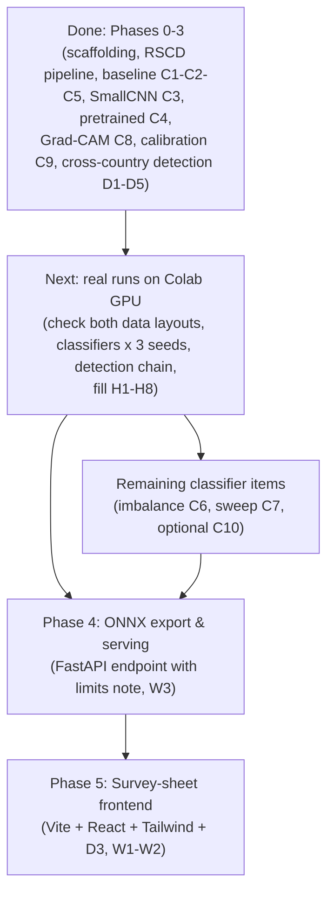

# Road Condition AI: System Guidance & Verification Manual

This document explains what has been built in the **Road Condition AI** repository, how each component works, and how you can check every requirement yourself against the [PRD](Road%20Condition%20AI%20PRD.pdf). Every command in section 4 was run on the mock dataset, and the outputs shown are the real ones.

---

## Table of Contents
1. [Executive Summary & Current Status](#1-executive-summary--current-status)
2. [PRD Requirements Coverage Matrix](#2-prd-requirements-coverage-matrix)
3. [What Was Built (Component Deep Dive)](#3-what-was-built-component-deep-dive)
   - [3.1 Configuration & Package Setup](#31-configuration--package-setup)
   - [3.2 The Anti-Leak RSCD Data Pipeline](#32-the-anti-leak-rscd-data-pipeline)
   - [3.3 The Synthetic Mock Data Engine](#33-the-synthetic-mock-data-engine)
   - [3.4 The Pure-NumPy Metric Engine](#34-the-pure-numpy-metric-engine)
   - [3.5 The Classical Machine Learning Baseline](#35-the-classical-machine-learning-baseline)
   - [3.6 PyTorch Dataset & Transforms](#36-pytorch-dataset--transforms)
   - [3.7 SmallCNN (Req C3)](#37-smallcnn-req-c3)
   - [3.8 Pretrained ResNet-50 & EfficientNet-B0 (Req C4)](#38-pretrained-resnet-50--efficientnet-b0-req-c4)
   - [3.9 Training Engine & Early Stopping](#39-training-engine--early-stopping)
   - [3.10 Temperature Scaling & Calibration (Req C9)](#310-temperature-scaling--calibration-req-c9)
   - [3.11 Grad-CAM Explainability (Req C8)](#311-grad-cam-explainability-req-c8)
   - [3.12 Standalone Cloud Scripts](#312-standalone-cloud-scripts)
   - [3.13 Exploratory Data Analysis (EDA) Notebook](#313-exploratory-data-analysis-eda-notebook)
   - [3.14 RDD2022 Data Layer (Parsing, Splits, YOLO Tree, Mock Data)](#314-rdd2022-data-layer-parsing-splits-yolo-tree-mock-data)
   - [3.15 Detection Metrics (Box Matching, F1, Domain Gap)](#315-detection-metrics-box-matching-f1-domain-gap)
   - [3.16 Source Detector (Req D1)](#316-source-detector-req-d1)
   - [3.17 Weather Augmentation (Req D2)](#317-weather-augmentation-req-d2)
   - [3.18 Few-Shot Fine-Tuning and the Learning Curve (Req D3, D5)](#318-few-shot-fine-tuning-and-the-learning-curve-req-d3-d5)
   - [3.19 Pseudo-Labelling (Req D4)](#319-pseudo-labelling-req-d4)
   - [3.20 Detection Command Line and Colab Scripts](#320-detection-command-line-and-colab-scripts)
4. [Step-by-Step Manual Verification Playbook](#4-step-by-step-manual-verification-playbook)
   - Phase 1: [Tests 1-6](#phase-1-data-pipeline-metrics-and-classical-baseline)
   - Phase 2: [Tests 7-13](#phase-2-deep-learning-classifier)
   - Phase 3: [Tests 14-20](#phase-3-cross-country-damage-detection)
5. [Reading the Results Against the PRD Hypotheses](#5-reading-the-results-against-the-prd-hypotheses)
6. [Running the Real Experiments on Google Colab](#6-running-the-real-experiments-on-google-colab)
7. [Known Limitations & Assumptions](#7-known-limitations--assumptions)
8. [What Remains to Be Built (Next Phases)](#8-what-remains-to-be-built-next-phases)

---

## 1. Executive Summary & Current Status

The repository contains the completed code for **Phase 0 (scaffolding)**, **Phase 1 (RSCD data pipeline and classical baseline)**, **Phase 2 (deep-learning surface classifier)** and **Phase 3 (cross-country YOLO damage detection and domain shift)**.

**What is verified:** all 106 automated tests pass on mock data (CPU only), `ruff` is clean on `src`, `tests` and `scripts`, and every command in section 4 runs. A real pretrained EfficientNet-B0 (weights downloaded from Hugging Face) has been run end to end through the classifier script, and a real COCO-pretrained YOLOv8n has been run through the whole detection chain (source detector, weather augmentation, few-shot, pseudo-labelling, report) on mock data.

**What is not verified yet:** no model has been trained on the real RSCD or RDD2022 data, so there are **no real accuracy numbers**. The GPU and mixed-precision (AMP) code paths have not been run, because they need a CUDA machine. The assumed RSCD and RDD2022 folder layouts (section 7) still have to be checked on the real downloads. Mock scores mean nothing: the mock classes differ only by colour or by drawn shapes.

### Why this foundation matters
1. **A leakage-free, balanced data subsetter** stops near-identical consecutive frames from inflating scores.
2. **A pure-NumPy evaluation system** reports macro-F1 instead of misleading raw accuracy.
3. **A classical baseline** (colour histograms + HOG into logistic regression and random forest) sets the bar the deep models must beat (hypothesis H1).
4. **Three deep classifiers with the same evaluation**, plus calibration and Grad-CAM, so the models can be compared fairly and their confidence and attention can be inspected.
5. **A cross-country detection study** that trains on one country, measures the accuracy lost on others, and compares three ways to win it back (weather augmentation, a few target labels, pseudo-labels) under the same held-out splits and metrics.

---

## 2. PRD Requirements Coverage Matrix

| PRD Req ID | Description | Status | Files | How to Verify |
| :--- | :--- | :--- | :--- | :--- |
| **C1** | EDA notebook: class counts, sample grid, image stats, split sanity checks | Complete | [`notebooks/01_rscd_eda.ipynb`](notebooks/01_rscd_eda.ipynb) | Open in Jupyter or Colab and run all cells |
| **C2** | Classical baseline: colour histogram + HOG into logistic regression & random forest | Complete | [`models/baseline.py`](src/roadcond/models/baseline.py) | Test 5 |
| **C3** | Small CNN written from scratch | Code complete, mock-verified; real run pending | [`models/small_cnn.py`](src/roadcond/models/small_cnn.py), [`train.py`](src/roadcond/train.py) | Tests 7, 9 |
| **C4** | Fine-tuned pretrained ResNet-50 / EfficientNet | Code complete, mock-verified; real run pending | [`models/pretrained.py`](src/roadcond/models/pretrained.py) | Tests 8, 9 |
| **C5** | Evaluation report: macro-F1, per-class precision/recall, confusion matrix | Complete | [`metrics.py`](src/roadcond/metrics.py) | Tests 1, 4 |
| **C6** | Imbalance handling compared (none / class-weighted / oversampling) | Not built | | |
| **C7** | Hyperparameter sweep with an experiment tracker | Not built (learning rate, freeze epochs and augmentation strength are in the config, ready for it) | | |
| **C8** | Grad-CAM heatmaps for correct and wrong predictions | Code complete, mock-verified; real run pending | [`explain.py`](src/roadcond/explain.py) | Test 10 |
| **C9** | Calibration: reliability diagram, ECE before and after temperature scaling | Code complete, mock-verified; real run pending | [`calibration.py`](src/roadcond/calibration.py) | Test 11 |
| **C10** | Optional ViT / DINOv2 comparison | Not built (P2) | | |
| **Data Rules** | Balanced 40k subset, official val/test untouched, near-duplicate rejection | Complete | [`data/rscd.py`](src/roadcond/data/rscd.py) | Test 3 |
| **D1** | YOLO detector trained on the source country, mAP per target country | Code complete, mock-verified; real run pending | [`detection/train_yolo.py`](src/roadcond/detection/train_yolo.py), [`data/rdd.py`](src/roadcond/data/rdd.py) | Tests 14-16, 19 |
| **D2** | Recovery experiment: stronger augmentation | Code complete, mock-verified; real run pending | [`detection/augment.py`](src/roadcond/detection/augment.py) | Tests 18, 20 |
| **D3** | Recovery experiment: fine-tuning with 10, 50 and 200 target labels, 3 seeds | Code complete, mock-verified; real run pending | [`detection/few_shot.py`](src/roadcond/detection/few_shot.py) | Tests 14, 19, 20 |
| **D4** | Recovery experiment: pseudo-labelling with a confidence threshold | Code complete, mock-verified; real run pending | [`detection/pseudo_label.py`](src/roadcond/detection/pseudo_label.py) | Tests 14, 19, 20 |
| **D5** | Learning curve: target mAP against number of labelled target images | Code complete, mock-verified; real run pending | [`detection/few_shot.py`](src/roadcond/detection/few_shot.py), [`detection/report.py`](src/roadcond/detection/report.py) | Tests 17, 20 |
| **Data Rules (detection)** | Own held-out split per country (no public test labels), saved lists, near-duplicate guard | Complete | [`data/rdd.py`](src/roadcond/data/rdd.py) | Test 16 |
| **W1-W3** | Demo (FastAPI + React/D3) | Later phase | | |

---

## 3. What Was Built (Component Deep Dive)

### 3.1 Configuration & Package Setup
- **[`pyproject.toml`](pyproject.toml)**: `hatchling` build backend, Python `>=3.11`, `src/` layout. The core install is light (`numpy`, `pillow`, `pyyaml`); heavy libraries are optional extras:
  - `classical`: `scikit-learn`, `scikit-image`, `joblib`
  - `train`: `roadcond[classical]`, `torch`, `torchvision`, `timm`, `grad-cam`, `pandas`, `matplotlib`, `tqdm`, `tensorboard`
  - `detect`: `ultralytics`, `albumentations` (kept separate: Ultralytics is AGPL-3.0)
  - `export`: `onnx`, `onnxruntime`; `serve`: `fastapi`, `uvicorn`, `python-multipart`, `pillow`, `onnxruntime`
  - `notebook`: `jupyterlab`, `matplotlib`; `dev`: `pytest`, `ruff`, `nbstripout`
- **[`configs/default.yaml`](configs/default.yaml)**: the single source of truth for settings:
  - Friction classes, ordered from dry to ice: `[dry, wet, water, fresh_snow, melted_snow, ice]`; image size `[240, 360]` (height, width).
  - Training subset: 40,000 images, fixed `seed: 0`. Dedup: 64-bit dHash, max Hamming distance 4.
  - `baseline:` feature sizes and the logistic regression / random forest grids.
  - `classifier:` batch size 64, workers 2, mixed precision on, weight decay 0.01, `augment_strength` 1.0, `freeze_epochs` 1, 15 calibration bins, and per-model settings:

    | Model | Epochs | Patience | Learning rate | Backbone LR |
    | :--- | :--- | :--- | :--- | :--- |
    | `small_cnn` | 30 | 6 | 0.001 | n/a (dropout 0.1) |
    | `resnet50` | 12 | 4 | 0.001 (head) | 0.0001 |
    | `efficientnet` (`efficientnet_b0`) | 12 | 4 | 0.001 (head) | 0.0001 |
  - `rdd2022:` (detection) the four damage classes (D00, D10, D20, D40 = ids 0-3), the source country (Japan) and targets (Norway, Czech, United_States), assumed folder names, the per-country split (70 / 10 / 20 %, seed 0, val capped at 500 images), the `yolo:` settings (YOLOv8n, 640 px, 30 epochs, source pool capped at 5,000 images), `augment:`, `few_shot:` (budgets 10 / 50 / 200, seeds 0 / 1 / 2) and `pseudo_label:` (threshold sweep 0.3 / 0.5 / 0.7). `metrics.detection_f1_conf` is 0.25.
- **[`config.py`](src/roadcond/config.py)**: `load_config()` and `resolve_path()`, so relative paths work from the repo root or from inside scripts.

### 3.2 The Anti-Leak RSCD Data Pipeline
- **File**: [`src/roadcond/data/rscd.py`](src/roadcond/data/rscd.py)
- **Problem it solves**: consecutive frames from one drive look almost identical. If one lands in train and the next in test, the model scores well without learning friction.
- **How it works**:
  1. **Label mapping (`to_friction`)**: turns a full RSCD label such as `wet_concrete_slight` into its friction class (`wet`). An unknown label stops the run with an error instead of being guessed.
  2. **Balanced subset (`balanced_subset`)**: 40,000 images split over 6 classes gives quotas of 6,667 (dry, wet, water, fresh snow) and 6,666 (melted snow, ice). Inside a class, `interleave_by_label` round-robins over the material and roughness sub-labels, so the subset is not dominated by smooth asphalt.
  3. **Perceptual hash (`dhash`)**: a 64-bit difference hash computed with PIL and NumPy. Unlike MD5/SHA it stays similar when brightness or JPEG compression changes slightly.
  4. **Near-duplicate index (`NearDuplicateIndex`)**: avoids comparing every train image with every val/test image. The 64 bits are split into `max_hamming + 1` = **five bands**. Two hashes within 4 bits must agree exactly on at least one band (pigeonhole principle), so only images sharing a band value are compared.
  5. **Leak check (`LeakChecker`)**: rejects a train image within `max_hamming` bits of any val/test image. If `rscd.dedup.drive_id_regex` is set, it also rejects train images that share a drive id with a val/test image.
  6. **Replacement**: a rejected image is replaced by another from the same class, so the subset stays balanced. If a class runs out, the shortfall is logged and written to the report.
  7. **Outputs**: `data/splits/rscd_train_subset.csv`, `rscd_val.csv`, `rscd_test.csv` (columns `path, friction, label`) and the audit log `rscd_leak_report.json`.
- **Untouched splits**: val and test are only listed, never sampled. The report also counts test images that nearly duplicate val images, for information only.

### 3.3 The Synthetic Mock Data Engine
- **File**: [`src/roadcond/data/mock.py`](src/roadcond/data/mock.py)
- **Problem it solves**: the full RSCD set is about a million images, and tests should not need a download.
- **How it works**: writes small synthetic images (coloured noise, *not* realistic road photos) in the layout the config assumes: `train/<label>/*.jpg` and flat, timestamped `vali_20k` / `test_50k` folders. It deliberately plants 2 near-duplicates of test images in the training folder (`leak_000.jpg`, `leak_001.jpg`) so the leak check can be proven to work.

### 3.4 The Pure-NumPy Metric Engine
- **File**: [`src/roadcond/metrics.py`](src/roadcond/metrics.py)
- **Functions**:
  - `confusion_matrix(y_true, y_pred, n_classes)`: rows are true classes, columns are predictions. Classes that never occur keep a row of zeros. Labels outside `0..n_classes-1` raise `ValueError`.
  - `precision_recall_f1(cm)`: per-class precision = TP/(TP+FP), recall = TP/(TP+FN), F1 = 2PR/(P+R). A zero denominator gives 0.0, matching scikit-learn's `zero_division=0`.
  - `macro_f1(y_true, y_pred, n_classes)`: the unweighted mean of per-class F1, so a weak rare class (ice) cannot hide behind a strong common one.
  - `accuracy(y_true, y_pred)`, `classification_report(y_true, y_pred, class_names)` (a JSON-ready dict with accuracy, macro-F1, per-class metrics and the confusion matrix).
  - `mean_std(values)` formats results over seeds as `mean ± std`; `format_table(headers, rows)` prints a Markdown table.

### 3.5 The Classical Machine Learning Baseline
- **File**: [`src/roadcond/models/baseline.py`](src/roadcond/models/baseline.py)
- **Features (`extract_features`)**: images are downscaled to 120 x 180, then:
  - 16-bin normalised histograms for each of R, G, B, H, S, V = **96** colour dimensions;
  - HOG on the grey image (9 orientations, 16 x 16 pixel cells, 2 x 2 cells per block) = **2,160** texture dimensions;
  - **2,256** dimensions in total.
- **Feature cache**: extraction runs in parallel (`ProcessPoolExecutor`) and is cached to `data/processed/rscd_features_{split}.npz`. The cache key covers the file list and settings, so a changed config recomputes it.
- **Models**: `StandardScaler` + logistic regression (`C` in {0.1, 1.0}) and a 300-tree random forest (`max_depth` in {None, 30}).
- **Integrity**: the grid is chosen on validation macro-F1 only. The test split is scored only with `--eval-test`.
- **Output**: `artifacts/results/baseline.json` (3 seeds: 0, 1, 2).

### 3.6 PyTorch Dataset & Transforms
- **File**: [`src/roadcond/data/dataset.py`](src/roadcond/data/dataset.py)
- `RoadDataset(records, root, classes, transform)` reads the saved split CSVs (via `load_splits`) and returns `(image tensor, class index)`. `load_raw(i, size)` returns the plain resized image for Grad-CAM overlays.
- `build_transforms(train, size, strength)` uses **torchvision v2**:
  - Training: resize to 240 x 360, random horizontal flip, mild colour jitter (brightness 0.2, contrast 0.2, saturation 0.1, scaled by `strength`), ImageNet normalisation. There is **no hue shift**: colour is a real cue for snow, ice and wet roads.
  - Validation / test: resize and normalise only (deterministic).
- `make_loader(...)` gives a seeded shuffle and drops the last partial batch in training (BatchNorm cannot train on a batch of one).

### 3.7 SmallCNN (Req C3)
- **File**: [`src/roadcond/models/small_cnn.py`](src/roadcond/models/small_cnn.py)
- Four stages of **Conv2d -> BatchNorm -> ReLU -> MaxPool -> Dropout2d** with 32, 64, 128 and 256 channels, then global average pooling and one linear layer to 6 classes. **390,438 parameters.**
- ReLU is not in-place, because Grad-CAM hooks that layer. `model.target_layer` points at the last stage's ReLU, before the final pooling (the largest feature map).

### 3.8 Pretrained ResNet-50 & EfficientNet-B0 (Req C4)
- **File**: [`src/roadcond/models/pretrained.py`](src/roadcond/models/pretrained.py)
- `build_pretrained(timm_name, num_classes, pretrained, freeze_backbone)` creates the timm model; timm replaces its classifier with a new 6-class linear head. Pretrained weights download from the Hugging Face hub on first use.
- `set_backbone_trainable(model, bool)` freezes or unfreezes everything except the head. `freeze_batchnorm_stats(model)` keeps BatchNorm layers in eval mode while the backbone is frozen, so their running statistics are not disturbed. `split_parameters` and `count_parameters` support the optimiser groups and the checks below.
- **Fine-tuning schedule**: the first `freeze_epochs` (1) epoch trains only the head. After that the whole network trains, with the backbone at a 10x smaller learning rate than the head.

### 3.9 Training Engine & Early Stopping
- **File**: [`src/roadcond/train.py`](src/roadcond/train.py)
- AdamW, cosine annealing over the epoch budget, cross-entropy loss, mixed precision on CUDA only.
- **Early stopping** (`EarlyStopper`): stops when validation macro-F1 has not improved for `patience` epochs (a tie is not an improvement).
- **Checkpoints**: `best.pt` on every improvement, `last.pt` every epoch (written via a temporary file, so a Colab disconnect cannot corrupt it). `--resume` continues from `last.pt`.
- `run_seed` trains one model with one seed, reloads the best weights, fits the temperature, scores validation (and test with `--eval-test`), writes plots and the optional Grad-CAM gallery. `main` runs all seeds and prints the results table.
- **Command line**: `--model small_cnn|resnet50|efficientnet`, `--eval-test`, `--resume`, `--gradcam N`, `--seeds`, `--epochs`, `--batch-size`, `--workers`, `--freeze-epochs`, `--device`, `--no-pretrained` (random weights, no download), `--limit N` (debug: at most N images per split).

### 3.10 Temperature Scaling & Calibration (Req C9)
- **File**: [`src/roadcond/calibration.py`](src/roadcond/calibration.py)
- `TemperatureScaler` learns one number T > 0 (stored as log T, so it stays positive) and divides the logits by it. It is fitted with L-BFGS on the negative log-likelihood of **validation** logits. Scaling never changes which class is predicted, only the confidence.
- `expected_calibration_error` splits predictions into 15 equal-width confidence bins and averages |accuracy - confidence| weighted by bin size. `reliability_bins` returns the per-bin data, and `save_reliability_plot` draws the before and after diagrams.
- **How to read T**: T > 1 means the model was over-confident and gets softened; T < 1 means it was under-confident and gets sharpened.
- **Held-out caveat**: ECE after scaling *on the validation set* is optimistic, because T was fitted there. Judge hypothesis H4 on the **test** numbers.

### 3.11 Grad-CAM Explainability (Req C8)
- **File**: [`src/roadcond/explain.py`](src/roadcond/explain.py)
- `gradcam(model, inputs, target_layer, class_ids)` uses `pytorch-grad-cam` and returns heatmaps of shape `(batch, 240, 360)` with values in [0, 1]. `default_target_layer` picks the last convolutional stage (`SmallCNN.target_layer`, ResNet `layer4[-1]`, EfficientNet `blocks[-1]`). It runs in eval mode and works even when all parameters are frozen.
- `overlay(raw, cam)` blends a heatmap onto the image; `select_examples` picks the most confident **mistakes** and a seeded random sample of correct predictions; `save_gallery` draws original and overlay rows, titled `true -> predicted (confidence)`. The confidence shown is the calibrated one.

### 3.12 Standalone Cloud Scripts
- [`scripts/prepare_rscd.py`](scripts/prepare_rscd.py): builds the split CSVs.
- [`scripts/train_baseline.py`](scripts/train_baseline.py): the classical baseline.
- [`scripts/train_classifier.py`](scripts/train_classifier.py): the deep classifiers.
- [`scripts/run_phase1.sh`](scripts/run_phase1.sh): split files, then baseline.
- [`scripts/run_phase2.sh`](scripts/run_phase2.sh): installs `timm` and `grad-cam`, then trains the three models in turn. It stops with a clear message if `data/splits/` is missing.

All scripts run from a repo clone without `pip install`.

### 3.13 Exploratory Data Analysis (EDA) Notebook
- **File**: [`notebooks/01_rscd_eda.ipynb`](notebooks/01_rscd_eda.ipynb), satisfying Requirement **C1**.
- Class counts per split, a sample grid per friction class, image sizes (PIL reports width x height), brightness and saturation per class (looking for lighting shortcuts), split sanity checks, and the image pairs flagged by the leak report.
- Set `RSCD_ROOT` to use real data. Without it the notebook builds a mock dataset so every cell still runs.

### 3.14 RDD2022 Data Layer (Parsing, Splits, YOLO Tree, Mock Data)
- **File**: [`src/roadcond/data/rdd.py`](src/roadcond/data/rdd.py)
- **Assumed input layout** (verify on the real download): `<root>/<Country>/train/images/*.jpg` with Pascal-VOC XML in `<root>/<Country>/train/annotations/xmls/*.xml`. The release has no public test labels, so its `test/` folder is not used.
- **Parsing** (`parse_voc_xml`): keeps the four classes the PRD names (D00 longitudinal crack = 0, D10 transverse crack = 1, D20 alligator crack = 2, D40 pothole = 3). Any other code in the XML (for example D43) is dropped and counted in the report, boxes are clamped to the image, and degenerate boxes are dropped. The D-codes come from the RDD2022 convention, not from the PRD, so check the `dropped_labels` counts on the real data. XML with a DTD or entities is rejected, because the files come from a download. YOLO label text is parsed and written too (`boxes_to_yolo`, `parse_yolo_text`, `yolo_to_xyxy`).
- **Own splits per country** (`split_annotations`): a seeded 70 % train-pool / 10 % val / 20 % test split of the labelled images. Val is capped at 500 images; the excess goes to the pool. The test split is scored once per final model.
- **Near-duplicate guard** (`drop_near_duplicates`): RDD frames come from video, so pool images that nearly duplicate a val or test image are dropped. It reuses the Phase 1 perceptual hash and band index.
- **Saved lists** (committed, in `data/splits/`): `rdd_<country>_pool.txt`, `_val.txt`, `_test.txt`, plus `rdd_japan_train.txt` (the capped source training set), `rdd_<country>_fewshot_n<N>_seed<S>.txt` for every few-shot subset, and `rdd_report.json` (counts, dropped codes, image sizes, dropped near-duplicates).
- **YOLO work tree** (`data/processed/rdd_yolo/<Country>/`): `images/` holds symlinks to the originals and `labels/` the YOLO label files. Ultralytics finds a label by swapping the last `images` folder in the image path for `labels`, so subsets (few-shot, pseudo-labelled mixes) are just list files and nothing is copied.
- **Data configs**: `data/splits/rdd_<country>.yaml` (`path`, `train`, `val`, `test`, `nc`, `names`). They contain absolute paths, so they are generated per machine and git-ignored.
- **Mock generator** (`make_mock_rdd`, `python -m roadcond.data.rdd --make-mock DIR`): synthetic road images (not photos) with drawn cracks and potholes in real RDD2022 folder layout and VOC XML. Each country has its own road colour, noise and image size, so the mock has a domain gap. About 15 % of images show no damage, and some XML objects use the unknown code D43.

### 3.15 Detection Metrics (Box Matching, F1, Domain Gap)
- **File**: [`src/roadcond/detection/metrics.py`](src/roadcond/detection/metrics.py), pure numpy.
- `box_iou`, `match_boxes` (greedy one-to-one, highest score first, same class only) and `f1_at_conf` (micro-averaged precision, recall and F1 over images, keeping predictions with score at or above a fixed confidence). The PRD asks for F1 at a fixed confidence; Ultralytics reports F1 at its own best threshold, so this part is our own. mAP@0.5 and mAP@0.5:0.95 come from Ultralytics.
- `relative_gap(source, target)` = (source - target) / source. `gap_recovered(source, zero_shot, method)` = (method - zero_shot) / (source - zero_shot), the share of the gap a method wins back. **Both return `None` when there is nothing to measure** (a non-positive source score, or a target that is not worse than the source), and the tables print `n/a`. This is on purpose: hypothesis H6 can fail, and a "negative recovery" would be misleading.
- `summarize` gives mean and sample standard deviation over seeds (no spread for a single value); `learning_curve` aggregates runs per country and budget; `format_curve_table` prints it.

### 3.16 Source Detector (Req D1)
- **File**: [`src/roadcond/detection/train_yolo.py`](src/roadcond/detection/train_yolo.py)
- YOLOv8n (switch with `--model yolov8s`), COCO-pretrained, 640 px, 30 epochs, trained on the source country only (the Japanese pool, capped at 5,000 images so a run fits a free Colab session). `best.pt` is chosen on the *source* validation split, which uses no target data.
- `evaluate_detector` returns mAP@0.5, mAP@0.5:0.95, precision, recall, F1 at 0.25 and per-class AP on one split. `evaluate_countries` scores Japan and the three targets; `domain_gaps` gives each target's relative gap for both mAP measures. Output: `artifacts/results/detection_source.json`.
- A finished run leaves `done.json` and is skipped on the next call; `--resume` continues an interrupted run from its `last.pt`.

### 3.17 Weather Augmentation (Req D2)
- **File**: [`src/roadcond/detection/augment.py`](src/roadcond/detection/augment.py)
- The question: how much of the gap closes with augmentation alone, with **no** target images? `weather_transforms(strength)` returns three Albumentations groups for Ultralytics' `augmentations=` argument: snow glare (snow, haze, over-exposure), wet pavement (gamma darkening, shadows, specular flare) and contrast changes (CLAHE, brightness / contrast).
- Every transform is pixel-level, so **boxes never move**. Rain streaks are left out deliberately: long thin streaks look like longitudinal cracks and would teach the wrong cue. Ultralytics stores augmentations in its checkpoints, so only built-in classes are used (no `A.Lambda`).
- `strength` scales how often and how strongly they apply (0 gives none). `source --augment` trains a second detector, `source_aug`, from the same start and scores it the same way. This simulates weather; it is not the real target look.

### 3.18 Few-Shot Fine-Tuning and the Learning Curve (Req D3, D5)
- **File**: [`src/roadcond/detection/few_shot.py`](src/roadcond/detection/few_shot.py)
- Fine-tunes the source detector on 10, 50 and 200 labelled images of a target country, for seeds 0, 1 and 2. Images are drawn from the pool images that have at least one box. Budgets are **nested per seed** (the 10 are inside the 50, inside the 200), which gives a cleaner curve.
- **Fixed recipe, never tuned on target data**: AdamW, learning rate 0.001, the first 10 layers frozen, no validation during training, and the *final* weights (`last.pt`) are scored on that country's test split. Small budgets get more epochs so that every budget sees at least 100 updates (10 images at batch 8 means 2 updates per epoch, so 50 epochs).
- Each run writes its own file (`artifacts/results/fewshot/<country>_n<N>_s<S>.json`, including the list of images used), so a Colab timeout loses nothing. `build_curve` and `save_learning_curve_plot` produce the table (mean ± std, relative gap, gap recovered) and `learning_curve.png`. Budget 0 is the source detector, trained once, so it has no spread.

### 3.19 Pseudo-Labelling (Req D4)
- **File**: [`src/roadcond/detection/pseudo_label.py`](src/roadcond/detection/pseudo_label.py)
- A seeded sample of up to 1,000 unlabelled target pool images is run through the source detector once, at the lowest sweep confidence. For each threshold, boxes at or above it become labels. Only images with at least one pseudo box are kept (an empty label would claim "no damage here", a much stronger statement than "nothing was confident").
- The detector is then fine-tuned from the source weights for 20 epochs on those images plus 2,000 replayed source images, so it does not forget the source domain. **No target label is used for training.**
- **Threshold selection**: 0.3, 0.5 and 0.7 are scored on target *validation* images with the first seed, and the best (ties go to the default 0.5) is used for every seed on the test split. This is the one place target labels influence a label-free method, and the results file records it (`threshold_selected_on`). The test split is never scored for the other thresholds.
- **Diagnostic**: the pool's hidden labels measure how precise the pseudo-labels were (`pseudo_label_precision`, `pseudo_label_recall`). Nothing uses them for training. A run where the detector found nothing confident is flagged `no_pseudo_labels`.

### 3.20 Detection Command Line and Colab Scripts
- [`src/roadcond/detection/cli.py`](src/roadcond/detection/cli.py), run through [`scripts/train_detection.py`](scripts/train_detection.py): the steps `prepare`, `source`, `source --augment`, `evaluate`, `fewshot`, `pseudo` and `report`. Common options: `--device`, `--no-pretrained` (random weights, no download), `--model`, `--imgsz`, `--batch`, `--workers`, `--epochs` (applies to the step being run), `--resume`, `--force`.
- [`src/roadcond/detection/report.py`](src/roadcond/detection/report.py) builds `artifacts/results/detection_report.md`: the domain-gap table (D1), augmentation vs baseline (D2), the learning curve (D3, D5), pseudo-labelling (D4) and a side-by-side table of all recovery methods. Sections for steps that have not run say so.
- [`scripts/run_phase3.sh`](scripts/run_phase3.sh) installs `ultralytics` and `albumentations`, then runs `prepare`, `source`, `source --augment`, `fewshot`, `pseudo` and `report`. Finished work is skipped, so rerunning the same command continues after a disconnect.

---

## 4. Step-by-Step Manual Verification Playbook

Run everything from the repository root. One-time setup:

```bash
python3 -m venv .venv && source .venv/bin/activate
pip install -e ".[dev,train,detect]"   # Phase 1 only needs ".[dev,classical]", Phase 2 ".[dev,train]"
```

### Phase 1: Data Pipeline, Metrics and Classical Baseline

#### Test 1: Run the Complete 106-Test Suite
```bash
pytest -v
```
**What to look for** (counts per file):

| File | Tests | Covers |
| :--- | :--- | :--- |
| `tests/test_setup.py` | 4 | package import, config loading, friction class order, damage class ids |
| `tests/test_metrics.py` | 14 | hand-computed confusion matrix, macro-F1, missing classes, bad labels, scikit-learn parity |
| `tests/test_rscd.py` | 19 | label mapping, both folder layouts, balanced and seeded subset, near-duplicate index vs brute force, planted leaks |
| `tests/test_baseline.py` | 2 | feature vector length and end-to-end training |
| `tests/test_dl.py` | 28 | Phase 2 (see Tests 7-13) |
| `tests/test_detection.py` | 39 | Phase 3 (see Tests 14-20) |

**Success criteria:** `106 passed` in roughly 25 seconds on a laptop CPU. Tests that need scikit-learn or torch are skipped automatically if those are not installed.

#### Test 2: Verify the Configuration Single Source of Truth
```bash
python3 -c "from roadcond.config import load_config; cfg = load_config(); print('Classes:', cfg['rscd']['classes'])"
```
Expected: `Classes: ['dry', 'wet', 'water', 'fresh_snow', 'melted_snow', 'ice']`

#### Test 3: Audit the Anti-Leak Duplicate Detector
```bash
# 1. Synthetic dataset with 2 planted leaks
python3 -m roadcond.data.mock --out data/raw/rscd_mock

# 2. Ask for more images than exist, so EVERY train image is checked
python3 scripts/prepare_rscd.py --root data/raw/rscd_mock \
    --splits-dir data/processed/mock_splits --train-size 10000

# 3. Read the audit
cat data/processed/mock_splits/rscd_leak_report.json
```
**Why 10000:** with a small `--train-size` (say 120), only that many images are drawn and checked, so the two planted leaks are usually never sampled and nothing is rejected. Asking for more than exists forces a full check.

**Expected:**
- Warnings that classes have fewer images than requested. This is normal: the mock has only 20 images per snow/ice label.
- In the report: `"train_candidates_checked": 542`, `"train_rejected_near_duplicate": 2`, `"train_rejected_shared_drive": 0`, and two `examples` pairing `train/.../leak_000.jpg` and `leak_001.jpg` with test images at distance 0.
- `rscd_val.csv` and `rscd_test.csv` list every val and test image (108 each at the default mock size) and are never altered.

#### Test 4: Verify Metric Math & Zero-Division Safety
```bash
python3 -c "
import numpy as np
from roadcond.metrics import confusion_matrix, macro_f1

# 3 classes (0: dry, 1: wet, 2: ice). The model misses class 2 completely.
y_true = np.array([0, 0, 1, 1, 2, 2])
y_pred = np.array([0, 0, 1, 1, 0, 1])
print(confusion_matrix(y_true, y_pred, n_classes=3))
print('Macro-F1:', round(macro_f1(y_true, y_pred, 3), 4))
"
```
Expected:
```text
[[2 0 0]
 [0 2 0]
 [1 1 0]]
Macro-F1: 0.5333
```
Per-class F1 is 0.8, 0.8 and 0.0, so the macro average is (0.8 + 0.8 + 0.0) / 3 = 0.5333. The failure on the rare class is fully penalised.

#### Test 5: Run the Classical Baseline on Mock Data
```bash
python3 scripts/train_baseline.py --root data/raw/rscd_mock \
    --splits-dir data/processed/mock_splits --cache-dir data/processed/mock_cache \
    --results artifacts/mock_results/baseline.json --eval-test
```
Expect feature extraction for train, val and test, then a table with `val macro-F1`, `test macro-F1` and accuracy for logistic regression and random forest as mean ± std over seeds 0, 1, 2, plus a per-class precision / recall table. Mock scores near 1.0 are meaningless.

#### Test 6: Verify Code Style
```bash
ruff check src tests scripts
ruff format --check src tests scripts
```
Expected: `All checks passed!`, then `... files already formatted`.

> `ruff check .` also lints the notebook and currently reports 6 style warnings there (mostly line length). They do not affect behaviour.

### Phase 2: Deep Learning Classifier

Phase 2 reads the split CSVs from Phase 1. The commands below use the mock splits from Test 3.

#### Test 7: Verify SmallCNN (Req C3)
```bash
python3 -c "
import torch
from roadcond.config import load_config
from roadcond.models.pretrained import count_parameters
from roadcond.train import build_model
model = build_model('small_cnn', load_config())
out = model(torch.randn(2, 3, 240, 360))
print('output shape:', tuple(out.shape))
print('parameters:', count_parameters(model))
print('stages:', len(model.features))
"
```
Expected:
```text
output shape: (2, 6)
parameters: 390438
stages: 4
```
The automated checks are `test_forward_loss_and_backward[small_cnn]` (forward pass, finite loss, gradients reach every parameter) and `test_small_cnn_is_small_and_has_four_stages`:
```bash
pytest tests/test_dl.py -v -k "small_cnn"
```

#### Test 8: Verify ResNet-50 and EfficientNet-B0 (Req C4)
```bash
python3 -c "
from roadcond.config import load_config
from roadcond.models.pretrained import count_parameters
from roadcond.train import build_model
cfg = load_config()
for name in ('resnet50', 'efficientnet'):
    model = build_model(name, cfg, pretrained=False, freeze_backbone=True)
    trainable = [n for n, p in model.named_parameters() if p.requires_grad]
    print(name, '| total', count_parameters(model), '| trainable', count_parameters(model, True), '|', trainable)
"
```
Expected:
```text
resnet50 | total 23520326 | trainable 12294 | ['fc.weight', 'fc.bias']
efficientnet | total 4015234 | trainable 7686 | ['classifier.weight', 'classifier.bias']
```
With the backbone frozen, only the new 6-class head trains (2048 x 6 + 6 = 12,294 for ResNet-50; 1280 x 6 + 6 = 7,686 for EfficientNet-B0). `pretrained=False` skips the weight download; the real runs use `pretrained=True`.

Automated checks:
- `test_freezing_leaves_only_the_head_trainable`: only the head has gradients, then everything after unfreezing.
- `test_freeze_batchnorm_stats_survives_train_mode`: BatchNorm stays in eval mode while frozen.
- `test_frozen_epoch_trains_only_the_head_and_keeps_bn_statistics`: runs a real frozen epoch and checks that the first convolution and BatchNorm statistics did not change while the head did.

```bash
pytest tests/test_dl.py -v -k "freez or frozen or forward"
```

#### Test 9: Train End to End on Mock Data (training loop, early stopping, checkpoints)
```bash
python3 scripts/train_classifier.py --model small_cnn \
    --root data/raw/rscd_mock --splits-dir data/processed/mock_splits \
    --out-dir artifacts/mock_dl --seeds 0 --epochs 2 --workers 0 --device cpu \
    --limit 200 --eval-test --gradcam 2
```
Takes about 30 seconds on a laptop CPU. Expect one log line per epoch (`train`, `val`, `macro-F1`, `acc`, with ` *` marking a new best), then a results table:

```text
| model     | val macro-F1 | test macro-F1 | test accuracy | test ECE before -> after | temperature | best epochs |
```
Check the files it wrote:
```bash
ls artifacts/mock_dl/checkpoints/small_cnn_seed0 artifacts/mock_dl/results
```
```text
best.pt  gradcam_test.png  history.json  last.pt  loss_curves.png  reliability_test.png
small_cnn.json
```
Open the three PNGs. `history.json` has one entry per epoch (train loss, validation loss, macro-F1, accuracy, learning rate, whether the backbone was frozen).

Repeat with `--model resnet50 --no-pretrained` or `--model efficientnet --no-pretrained` to exercise the other two architectures without a download. Drop `--no-pretrained` to use the real ImageNet weights (downloaded once; EfficientNet-B0 on a CPU took about a minute and a half for 2 epochs on 120 images).

**Resume check** (simulates a Colab timeout): rerun the same command with `--epochs 3 --resume`. The log shows `Resumed from .../last.pt at epoch 2` (a 0-based epoch index), trains only epoch 3, and `history.json` then lists epochs `[0, 1, 2]`. Automated: `test_fit_resumes_from_last_checkpoint`, `test_early_stopper_stops_after_patience_and_keeps_best`.

**Whole pipeline check, automated:** `test_cli_end_to_end_on_mock` runs the full command line (2 seeds, test scoring, Grad-CAM) and checks the results JSON and every output file.

#### Test 10: Verify Grad-CAM (Req C8)
```bash
python3 -c "
import torch
from roadcond.config import load_config
from roadcond.explain import gradcam
from roadcond.train import build_model
model = build_model('small_cnn', load_config())
cam = gradcam(model, torch.randn(2, 3, 240, 360))
print('shape', cam.shape, 'min', round(float(cam.min()), 3), 'max', round(float(cam.max()), 3))
"
```
Expected: `shape (2, 240, 360) min 0.0 max 1.0` (one heatmap per image at input resolution, each scaled to [0, 1]).

Then look at the gallery from Test 9: `artifacts/mock_dl/checkpoints/small_cnn_seed0/gradcam_test.png`. The top row shows the original images and the bottom row the heatmaps. Columns titled `correct` show random correct predictions; columns titled `wrong` show the most confident mistakes. Each title reads `true -> predicted (confidence)`. Warm colours (red) mark pixels that pushed the model toward its predicted class. On a *trained* model, check whether those pixels sit on the road surface or on shortcuts such as sky, shadows or vehicle parts (hypothesis H5).

Automated checks: `test_gradcam_shape_range_and_determinism` (all three models, the same input twice gives the same map), `test_gradcam_explains_the_requested_class`, `test_gradcam_works_with_frozen_parameters`, `test_overlay_returns_uint8_image_and_checks_sizes`, `test_select_examples_takes_most_confident_mistakes`.
```bash
pytest tests/test_dl.py -v -k "gradcam or overlay or select_examples"
```

#### Test 11: Verify Temperature Scaling & ECE (Req C9)
A synthetic model that is 70% accurate but extremely confident:
```bash
python3 -c "
import numpy as np, torch, torch.nn.functional as F
from roadcond.calibration import TemperatureScaler, expected_calibration_error
rng = np.random.default_rng(0)
n, k = 4000, 6
labels = rng.integers(0, k, n)
wrong = (labels + rng.integers(1, k, n)) % k
pred = np.where(rng.random(n) < 0.7, labels, wrong)
logits = rng.normal(0, 0.5, (n, k)); logits[np.arange(n), pred] += 6.0
logits_t = torch.tensor(logits, dtype=torch.float32)
scaler = TemperatureScaler().fit(logits_t, torch.tensor(labels))
before = expected_calibration_error(F.softmax(logits_t, 1).numpy(), labels)
after = expected_calibration_error(F.softmax(scaler(logits_t).detach(), 1).numpy(), labels)
print(f'accuracy {np.mean(pred == labels):.3f}  T {scaler.temperature:.2f}  ECE {before:.3f} -> {after:.3f}')
"
```
Expected: `accuracy 0.700  T 2.45  ECE 0.284 -> 0.030`. The model claimed about 99% confidence at 70% accuracy; scaling by T = 2.45 brings the confidence down to match.

Automated checks (`pytest tests/test_dl.py -v -k "ece or temperature or reliability"`):
- `test_ece_is_zero_for_perfect_confident_predictions` and `test_ece_hand_example` (confidence 0.9 at 50% accuracy gives ECE = 0.4).
- `test_reliability_bins_count_every_sample`.
- `test_temperature_scaling_fixes_overconfident_logits`: T > 1.5, NLL drops, predictions are unchanged, ECE at least halves.

In a real run, the numbers are in `results/<model>.json` under `models -> <model> -> [run] -> test -> calibration`: `temperature`, `ece_before`, `ece_after`, `nll_before`, `nll_after`, and the bin data behind `reliability_test.png`. Remember that the mock run in Test 9 can give T < 1 (it gave 0.03): with a tiny, barely trained model the network is under-confident, and the scaler correctly sharpens it. Do not read anything into mock calibration numbers. Scaling can even make ECE *worse* on test: a 1-epoch `--model resnet50 --no-pretrained --limit 60` run went from 0.157 to 0.315, because T was fitted on a tiny validation set. That is exactly the outcome H4 has to be able to fail with, so always compare `ece_before` and `ece_after` on test rather than assuming scaling helps.

#### Test 12: Verify the Dataset & Transforms
```bash
pytest tests/test_dl.py -v -k "transform or dataset or loader"
```
Checks that tensors are `(3, H, W)` floats, labels match the CSV, an unknown class raises an error, evaluation transforms are deterministic, training transforms are reproducible under a fixed seed, and that `strength=0` removes the colour jitter.

#### Test 13: Run the Whole Phase 2 Test File
```bash
pytest tests/test_dl.py -v
```
Expected: `28 passed` in about 15 seconds on a laptop CPU, using `pretrained=False` everywhere (no network).

### Phase 3: Cross-Country Damage Detection

Phase 3 needs the `detect` extra (Ultralytics, Albumentations). Everything below uses the synthetic mock dataset and git-ignored folders (`data/raw/rdd_mock`, `data/processed/rdd_mock_*`, `artifacts/mock_det`), so it never touches `data/splits/`.

#### Test 14: Run the Phase 3 Test File
```bash
pytest tests/test_detection.py -v
```
Expected: `39 passed` in about 10 seconds, with no download (random-weight YOLOv8n, 64-pixel images). What it covers:
- **Parsing**: `test_parse_voc_xml_*`, `test_yolo_round_trip`, `test_parse_yolo_text_rejects_malformed_lines`, `test_label_path_for_swaps_only_the_last_images_folder`.
- **Splits and data configs**: `test_split_*` (seeded, disjoint, val cap), `test_dedup_guard_drops_pool_images_that_copy_held_out_images`, `test_prepare_writes_lists_yaml_and_yolo_tree`, plus the mock-generator tests.
- **Metrics on hand-made boxes**: IoU, greedy matching, F1 at a fixed confidence, relative gap, gap recovered, mean ± std, the learning curve.
- **Augmentation**: pixels change, boxes never move, seeded, and savable in a checkpoint.
- **Budgets and pseudo-labels**: `test_budget_subsets_are_nested_seeded_and_validated`, `test_fewshot_epochs_give_tiny_budgets_enough_updates`, `test_pseudo_rows_filter_by_confidence_and_convert_to_yolo`.
- **A real Ultralytics run end to end** (the `pipeline` fixture): source training and scoring on four countries, a skipped second call, few-shot runs that resume from saved results, a pseudo-label sweep that never scores test for the unchosen thresholds, and the report and command line.

#### Test 15: Parse an RDD2022 Annotation
```bash
python3 -c "
from roadcond.config import load_config
from roadcond.data.rdd import class_ids, parse_voc_xml, boxes_to_yolo
xml = '''<annotation><size><width>200</width><height>100</height></size>
<object><name>D00</name><bndbox><xmin>10</xmin><ymin>20</ymin><xmax>50</xmax><ymax>60</ymax></bndbox></object>
<object><name>D40</name><bndbox><xmin>-5</xmin><ymin>80</ymin><xmax>300</xmax><ymax>120</ymax></bndbox></object>
<object><name>D43</name><bndbox><xmin>1</xmin><ymin>1</ymin><xmax>9</xmax><ymax>9</ymax></bndbox></object></annotation>'''
w, h, boxes, dropped = parse_voc_xml(xml, class_ids(load_config()))
print(w, h)
for b in boxes: print(b)
print('dropped:', dict(dropped))
print(boxes_to_yolo(boxes, w, h))
"
```
Expected:
```text
200 100
Box(cls=0, xmin=10.0, ymin=20.0, xmax=50.0, ymax=60.0)
Box(cls=3, xmin=0.0, ymin=80.0, xmax=200.0, ymax=100.0)
dropped: {'D43': 1}
['0 0.150000 0.400000 0.200000 0.400000', '3 0.500000 0.900000 1.000000 0.200000']
```
D00 and D40 map to class ids 0 and 3; the pothole box that stuck out of the image was clamped to it; the unknown code D43 was dropped and counted; the YOLO lines are `class cx cy w h` as fractions of the image.

#### Test 16: Build Mock Data, Per-Country Splits and the YOLO Tree
```bash
python3 -m roadcond.data.rdd --make-mock data/raw/rdd_mock
python3 scripts/train_detection.py prepare --root data/raw/rdd_mock \
    --splits-dir data/processed/rdd_mock_splits --work-dir data/processed/rdd_mock_yolo
```
Expected (40 mock images per country, so 28 / 4 / 8):
```text
Wrote mock RDD2022 to .../data/raw/rdd_mock: {'Japan': 40, 'Norway': 40, 'Czech': 40, 'United_States': 40}
Japan: 40 labelled, splits {'train_pool': 28, 'val': 4, 'test': 8}, 0 near-duplicates dropped, dropped labels {'D43': 4}
Norway: 40 labelled, splits {'train_pool': 28, 'val': 4, 'test': 8}, 0 near-duplicates dropped, dropped labels {'D43': 4}
Czech: 40 labelled, splits {'train_pool': 28, 'val': 4, 'test': 8}, 0 near-duplicates dropped, dropped labels {'D43': 2}
United_States: 40 labelled, splits {'train_pool': 28, 'val': 4, 'test': 8}, 0 near-duplicates dropped, dropped labels {'D43': 6}
```
Then inspect what it wrote:
```bash
ls data/processed/rdd_mock_splits                       # per-country lists, the YAMLs and rdd_report.json
head -3 data/processed/rdd_mock_splits/rdd_norway_test.txt
cat data/processed/rdd_mock_splits/rdd_norway.yaml     # path, train, val, test, nc: 4, names: D00 ... D40
ls data/processed/rdd_mock_yolo/Norway/labels | head -2
ls -l data/processed/rdd_mock_yolo/Norway/images | head -3   # the images are symlinks
```
Things to check: the three splits of a country share no image (`test_prepare_writes_lists_yaml_and_yolo_tree` asserts it); every image has a `.txt` label next to it in the `labels` folder; `rdd_japan_train.txt` exists only for the source country; `rdd_report.json` lists `dropped_labels`, `image_sizes` and the dropped near-duplicates. The mock images deliberately differ per country (road colour, noise, size).

#### Test 17: Check the Gap and Recovery Arithmetic
```bash
python3 -c "
from roadcond.detection.metrics import relative_gap, gap_recovered, f1_at_conf
print(f'relative gap (0.80 -> 0.60): {relative_gap(0.80, 0.60):.3f}')
print(f'recovered at 0.70: {gap_recovered(0.80, 0.60, 0.70):.3f}')
print('target better than source ->', round(relative_gap(0.70, 0.80), 3), gap_recovered(0.70, 0.80, 0.85))
pred = [{'boxes': [[0,0,10,10],[20,20,30,30]], 'scores': [0.9, 0.3], 'cls': [0, 1]}]
gt = [{'boxes': [[0,0,10,10],[20,20,30,30]], 'cls': [0, 1]}]
for conf in (0.25, 0.5):
    r = f1_at_conf(pred, gt, conf)
    print('conf', conf, '-> tp/fp/fn', r['tp'], r['fp'], r['fn'], 'F1', round(r['f1'], 3))
"
```
Expected:
```text
relative gap (0.80 -> 0.60): 0.250
recovered at 0.70: 0.500
target better than source -> -0.143 None
conf 0.25 -> tp/fp/fn 2 0 0 F1 1.0
conf 0.5 -> tp/fp/fn 1 0 1 F1 0.667
```
Source 0.80 and target 0.60 give a relative gap of (0.80 - 0.60) / 0.80 = 25 %; a method reaching 0.70 wins back half of that gap. When the target scores *higher* than the source, the gap is negative and "recovered" is `None` (printed `n/a`). Raising the confidence from 0.25 to 0.5 drops the 0.3-confidence box, so one real defect is missed and recall falls.

#### Test 18: Verify the Weather Augmentation Never Moves a Box
```bash
python3 -c "
import numpy as np
from roadcond.detection.augment import apply_to_sample, weather_transforms
rng = np.random.default_rng(0)
image = rng.integers(60, 200, (128, 160, 3), dtype=np.uint8)
rows = [[0, 0.5, 0.5, 0.2, 0.3], [3, 0.2, 0.7, 0.1, 0.1]]
for strength in (0.5, 1.0, 2.0):
    changed = 0
    for seed in range(12):
        out, boxes = apply_to_sample(image, rows, strength, seed)
        assert np.allclose(boxes[:, 1:], np.array(rows)[:, 1:], atol=1e-6), 'boxes moved'
        changed += int(not np.array_equal(out, image))
    print(f'strength {strength}: image changed in {changed}/12 draws, boxes never moved')
print('strength 0 gives', weather_transforms(0))
"
```
Expected:
```text
strength 0.5: image changed in 4/12 draws, boxes never moved
strength 1.0: image changed in 7/12 draws, boxes never moved
strength 2.0: image changed in 12/12 draws, boxes never moved
strength 0 gives []
```
Higher strength changes the picture more often, and the boxes are identical every time, because all transforms are pixel-level. Automated: `test_weather_augmentation_changes_pixels_but_never_boxes` and `test_weather_augmentation_can_be_saved_in_checkpoints`.

#### Test 19: Run the Whole Chain on Mock Data (random weights, plumbing only)
```bash
D="--splits-dir data/processed/rdd_mock_splits --work-dir data/processed/rdd_mock_yolo --out-dir artifacts/mock_det --no-pretrained --device cpu --workers 0"
python3 scripts/train_detection.py source  $D --imgsz 128 --epochs 3
python3 scripts/train_detection.py fewshot $D --imgsz 128 --budgets 10 --seeds 0 1 --countries Norway
python3 scripts/train_detection.py pseudo  $D --imgsz 128 --epochs 3 --thresholds 0.01 --seeds 0 1 --countries Norway
python3 scripts/train_detection.py report  $D --imgsz 128
```
(`D` is a plain string; in zsh write `${=D}` or paste the options in.) Each step takes seconds. With random weights and 3 epochs the detector learns nothing, so **every score is 0.000 and every gap is `n/a`**. That is the expected output here: this test only proves that the steps run, hand their files to each other and write `artifacts/mock_det/results/*.json` and `detection_report.md`. The source step prints a table of mAP@0.5, mAP@0.5:0.95 and F1 per country, then `relative gap <country>: n/a`. Rerun a step and it finishes instantly: finished work is skipped. Add `--force` to redo it.

#### Test 20: A Meaningful Mock Run With Pretrained Weights
This is the check that the numbers can move. It uses COCO-pretrained YOLOv8n (a 6 MB download on first use), 150 mock images per country, and a small config written on the fly. It takes about 4 minutes on a laptop CPU.
```bash
python3 - <<'EOF'
import yaml
from roadcond.config import load_config
from roadcond.data.rdd import make_mock_rdd
cfg = load_config(); r = cfg["rdd2022"]
r["split"].update(train_pool=0.6, val=0.1, test=0.3, max_val_images=15)
r["yolo"].update(imgsz=128, epochs=25, batch=16, workers=0, max_train_images=100)
r["few_shot"].update(epochs=30, min_iterations=60, batch=8, seeds=[0, 1, 2])
r["label_budgets"] = [0, 10, 30]
r["pseudo_label"].update(pool_size=60, source_replay=40, epochs=15, batch=16,
                         sweep=[0.25, 0.5], confidence_threshold=0.25, seeds=[0, 1])
open("data/processed/rdd_mock_pretrained.yaml", "w").write(yaml.safe_dump(cfg))
make_mock_rdd("data/raw/rdd_mock150", cfg, n_images=150)
EOF
bash scripts/run_phase3.sh data/raw/rdd_mock150 --config data/processed/rdd_mock_pretrained.yaml \
    --splits-dir data/processed/rdd_mock150_splits --work-dir data/processed/rdd_mock150_yolo \
    --out-dir artifacts/mock_det150 --device cpu --workers 0
```
The last step prints the report (also saved as `artifacts/mock_det150/results/detection_report.md`, with `learning_curve.png` beside it). Example output from one run of exactly these commands; **yours will differ**, for the reason explained below:
```text
## D1: source detector, scored on each country's held-out test split (F1 at conf 0.25)
| country        | mAP@0.5 | mAP@0.5:0.95 | F1    | gap (mAP@0.5) | gap (mAP@0.5:0.95) |
| Japan (source) | 0.834   | 0.549        | 0.842 | -             | -                  |
| Norway         | 0.697   | 0.448        | 0.724 | 16.4%         | 18.4%              |
| Czech          | 0.788   | 0.525        | 0.742 | 5.5%          | 4.3%               |
| United_States  | 0.876   | 0.542        | 0.748 | -5.0%         | 1.3%               |

## Recovery methods side by side (mAP@0.5, share of gap recovered)
| country       | 0 labels | + augmentation | + pseudo-labels              | 10 labels                     | 30 labels                     |
| Norway        | 0.697    | 0.759 (45.1%)  | 0.698 ± 0.008 (0.3 ± 6.2%)   | 0.695 ± 0.022 (-1.9 ± 16.4%)  | 0.760 ± 0.026 (45.7 ± 18.8%)  |
| Czech         | 0.788    | 0.757 (-67.1%) | 0.808 ± 0.030 (44.5 ± 64.5%) | 0.765 ± 0.019 (-50.3 ± 41.9%) | 0.844 ± 0.020 (122.1 ± 44.3%) |
| United_States | 0.876    | 0.854 (n/a)    | 0.868 ± 0.053 (n/a)          | 0.735 ± 0.009 (n/a)           | 0.848 ± 0.025 (n/a)           |
```
**The same commands do not give the same numbers twice.** An earlier run on identical mock data and seeds gave a Norway gap of 7.1 % (not 16.4 %), a Czech gap of -0.4 % (not 5.5 %) and a source score of 0.820 (not 0.834). CPU training is not bit-for-bit reproducible, the mock test sets hold only 45 images, and the single source detector is a source of variation of its own. Treat any one mock number as noise.

How to read it, and what **not** to read into it:
- A gap can be positive or negative, and it moves between runs. Where it is negative (the United States here: -5.0 %), the target scored *above* Japan, "gap recovered" is `n/a`, and hypothesis H6 has failed for that country. The tables report that honestly.
- "Share of gap recovered" divides by the gap, so when the gap is only a few points it swings wildly (Czech: -67 % for augmentation, 122 % for 30 labels). Read the mAP values and their spreads first, and the percentage second.
- The spread at 10 labels is large (± 16 to 42 % of the gap), and 30 labels is tighter: small label budgets are noisy, which is why every budget runs over 3 seeds.
- Pseudo-label precision (`detection_pseudo.json`, `pseudo_label_precision`) was 0.84, 0.62 and 0.91 for Norway, Czech and the United States. Czech chose threshold 0.25 on validation, and its labels were the least precise.
- **None of these numbers say anything about real roads.** They show that every step runs on a model that can learn something, and that the arithmetic and tables are right. For the real study, the 3-seed spreads cover only target sampling and fine-tuning; if the source detector's own variation matters, train it with more than one seed (3 times the most expensive step).

---

## 5. Reading the Results Against the PRD Hypotheses

Once real results exist (`artifacts/results/baseline.json`, `small_cnn.json`, `resnet50.json`, `efficientnet.json` for the classifiers; `detection_source.json`, `detection_source_aug.json`, `detection_pseudo.json`, `fewshot/*.json` and `detection_report.md` for detection), each deep-model file has the same layout as the baseline file:

| Hypothesis | Where to look | Counts as confirmed if |
| :--- | :--- | :--- |
| **H1** fine-tuned > small CNN > classical | `test macro-F1` column of each model's printed table (mean ± std over 3 seeds) | the order holds on the untouched test set over 3 seeds |
| **H2** similar classes are confused most | `test -> confusion_matrix` in the JSON (rows true, columns predicted; classes ordered dry to ice) | the largest off-diagonal cells are between neighbouring classes (wet/water, fresh/melted snow) |
| **H3** imbalance hurts rare classes | not testable yet: needs C6 | |
| **H4** over-confident, fixed by temperature scaling | `test -> calibration -> ece_before` vs `ece_after`, and `reliability_test.png` | ECE drops after scaling **on test** |
| **H5** Grad-CAM shows shortcuts | `gradcam_test.png`, wrong columns | a few wrong predictions are explained by where the model looked |
| **H6** a Japan-trained detector loses accuracy on Norway, Czech and the USA | `detection_report.md` D1 table (`artifacts/results/detection_source.json`, `gaps`) | each target's mAP is below the source mAP, with the gap stated per country. A negative gap means H6 failed for that country: report it as such |
| **H7** a few target labels recover a large part of the gap | D3 / D5 learning-curve table and `learning_curve.png` (0, 10, 50, 200 labels, mean ± std over 3 seeds) | the curve rises, and you can say where it flattens. Where the zero-shot gap is not positive, "recovered" is `n/a` |
| **H8** labels beat augmentation, and pseudo-labelling lands in between | the "side by side" table in `detection_report.md` (D2, D3, D4 at the same country) | the ranking holds across seeds, or you report that it does not. Note that D2 and D4 use no target labels, while D3 uses 10-200, so compare them as "free" versus "paid" methods |

Reporting rules from the PRD: tune on validation only, run `--eval-test` once per final model, report mean and spread over at least 3 seeds, and publish disappointing results too.

---

## 6. Running the Real Experiments on Google Colab

Full instructions and cells are in the [README](README.md). In short:

1. Use a **GPU runtime**; clone the repo; unzip RSCD to local disk (`/content/rscd`), not Drive.
2. Phase 1: `bash scripts/run_phase1.sh /content/rscd`, then commit `data/splits/` (or keep it in the same session).
3. Phase 2: `bash scripts/run_phase2.sh /content/rscd` (validation only), then once `bash scripts/run_phase2.sh /content/rscd --eval-test --gradcam 4`.
4. After a timeout, rerun with `--resume`. Copy `artifacts/` to Drive before the session ends.
5. Do a short dry run first: `python scripts/train_classifier.py --model resnet50 --root /content/rscd --limit 500 --epochs 1`.
6. Phase 3 (needs the RDD2022 download on local disk, e.g. `/content/rdd2022`): `bash scripts/run_phase3.sh /content/rdd2022`. Rerun the same command after a disconnect (add `--resume` to continue a half-trained source detector), and copy `artifacts/` and `data/splits/rdd_*.txt` to Drive. A dry run first: `bash scripts/run_phase3.sh /content/rdd2022 --epochs 1 --imgsz 320`.

---

## 7. Known Limitations & Assumptions

- **No real results yet.** Everything above is verified on mock data. The GPU / mixed-precision path is untested, and real training time per epoch has not been measured.
- **RSCD layout is assumed**, not confirmed: `train/<label>/` folders and flat `vali_20k` / `test_50k` folders with the label in the file name. If the real download differs, change `rscd.split_dirs` or `rscd.label_source` in `configs/default.yaml`. An unknown label stops the run with an error.
- **`240 x 360` orientation**: the PRD does not say whether this is height x width. The config assumes height x width; the EDA notebook prints the real sizes.
- **Near-duplicate threshold** (4 bits) is a starting value. Plain snow or ice images may be flagged even when they are different scenes: inspect the flagged pairs in the notebook. If file names carry a drive or date id, set `rscd.dedup.drive_id_regex` to also catch frames from the same drive.
- **Mock classes differ only by colour**, so mock scores are near-perfect (or erratic on tiny runs) and say nothing about real performance.
- **Not built yet:** imbalance handling (C6), hyperparameter sweep and tracker (C7), ViT/DINOv2 (C10), the ONNX export, the API and the demo.
- The EDA notebook has 6 `ruff` style warnings; `src`, `tests` and `scripts` are clean.

**Phase 3 (detection) specifics**
- **RDD2022 layout and codes are assumed**, not confirmed: `<root>/<Country>/train/images` plus `train/annotations/xmls`, country folder names `Japan`, `Norway`, `Czech`, `United_States`, and the damage codes D00 / D10 / D20 / D40 (the PRD names the classes but not the codes). Check `rdd_report.json` on the real data: `dropped_labels` (other codes in the XML), `images_without_xml`, `unreadable_xml` and `image_sizes`. If folders differ, change `rdd2022.countries`, `images_dir` and `annotations_dir` in the config.
- **Image sizes differ a lot between countries** (the Norwegian images are reported to be far larger than the Japanese ones; check `image_sizes`). Resizing everything to 640 px makes thin cracks much smaller in the large images, which is itself part of the "domain shift" you will measure. Higher `--imgsz` costs time.
- **Source detector trained once** (seed 0), so budget 0 has no spread; the three seeds cover which target images are sampled and the fine-tuning. Training it three times would triple the most expensive step. This matters: two runs of the same commands on the same mock data moved the Norway gap from 7.1 % to 16.4 % (Test 20), so a single source detector is a real source of uncertainty in every gap you report.
- **Source pool capped at 5,000 Japanese images** to fit a free Colab session (`--max-train-images` changes it). Say so in the write-up.
- **Our own choices where the PRD is silent:** F1 at confidence 0.25, default pseudo-label threshold 0.5 with a 0.3 / 0.5 / 0.7 sweep, 70 / 10 / 20 % splits, 30 epochs for the source detector.
- **Pseudo-label thresholds are chosen on target validation images**, so that one choice uses target labels; the results file records it.
- **A negative or zero gap is possible** (a target scoring as well as or better than Japan, as two of the three mock targets do). The report then prints `n/a` for "gap recovered" instead of a misleading number.
- **Near-duplicate guard** (4-bit threshold) is a starting value; RDD2022 images come from video, so inspect `near_duplicate_examples` in `rdd_report.json`.
- **Training time is unmeasured.** A rough, unmeasured guess is 5-9 GPU hours for the whole chain on a free T4, spread over several sessions; the per-run result files and `--resume` exist for that reason.
- **Ultralytics is AGPL-3.0.** It is isolated in the optional `detect` extra. Decide the repository licence deliberately before publishing code, weights or a demo that include it.

---

## 8. What Remains to Be Built (Next Phases)



### Immediate next step
Run the real experiments (section 6): confirm the RSCD layout with the EDA notebook and the RDD2022 layout with `rdd_report.json`, build the real split files, train the three classifiers, run the detection chain, and read the results against H1-H8.
